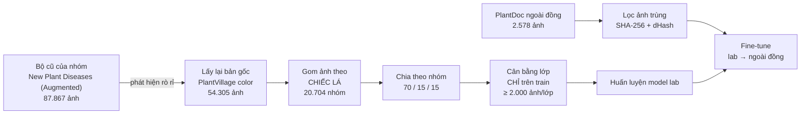

# Bộ dữ liệu của nhóm: PlantVillage (chia theo chiếc lá) + PlantDoc (ảnh ngoài đồng)

> Tài liệu này giới thiệu bộ dữ liệu cả nhóm dùng chung: dữ liệu lấy từ đâu, đã biến đổi và xử lý ra sao, và vì sao làm như vậy.
> Mọi con số dưới đây được đếm lại trực tiếp từ các thư mục dữ liệu và từ output của notebook.

---

## 1. Tóm tắt nhanh

| Thuộc tính | Giá trị |
|---|---|
| **Bài toán** | Phân loại ảnh lá cây → **38 lớp** (14 loại cây; 26 lớp bệnh + 12 lớp lá khỏe) |
| **Nguồn 1: ảnh phòng lab** | PlantVillage *color*, bản gốc từ [github.com/spMohanty/PlantVillage-Dataset](https://github.com/spMohanty/PlantVillage-Dataset) (commit `7f7ecc7`): **54.305 ảnh** |
| **Nguồn 2: ảnh ngoài đồng** | PlantDoc (file `data_plantdoc_80_20.zip` trên Drive của nhóm): **2.578 ảnh, 28 lớp** |
| **Bản chia lab nhóm dùng** | train **38.039**, valid **8.147**, test **8.098** (chia theo chiếc lá, 70/15/15) |
| **Train sau khi cân bằng** | **81.146 ảnh** (38.039 ảnh thật + 43.107 ảnh sinh thêm); mỗi lớp có ít nhất 2.000 ảnh |
| **PlantDoc sau khi làm sạch** | train **1.873**, valid **448**, test **221** |
| **Nơi tải** | Kaggle: [`duydangkaggle/plantvillage-leaf-grouped-split`](https://www.kaggle.com/datasets/duydangkaggle/plantvillage-leaf-grouped-split) (version 2) |
| **Giấy phép** | PlantVillage CC BY-SA 3.0; PlantDoc CC BY 4.0 |

---

## 2. Hành trình xử lý dữ liệu (tóm tắt để trình bày)



Ba ý chính khi nói với thầy:

1. **Bộ dữ liệu ban đầu bị "lộ đề".** Ảnh đã được nhân bản (xoay, lật) *trước* khi chia, nên bản sao của cùng một tấm ảnh nằm ở cả train lẫn valid. Điểm 99,95% vì vậy bị thổi phồng.
2. **Nhóm làm lại từ bản gốc, theo đúng thứ tự:** gom ảnh theo chiếc lá → chia → chỉ nhân bản trên train.
3. **Ảnh lab quá "dễ" so với thực tế.** Model đạt 99% trên ảnh lab nhưng chỉ đạt 19,5% macro-F1 trên ảnh ngoài đồng. Nhóm thêm PlantDoc để dạy model quen với ảnh thật.

---

## 3. Quy trình chi tiết từng bước

### Bước 0: Vấn đề của bộ dữ liệu cũ

Lúc đầu nhóm dùng `data.tar.gz` trên Drive, chính là bộ Kaggle **"New Plant Diseases Dataset (Augmented)"** (train 70.295 / valid 17.572).

**Ví dụ đời thường:** giống như thầy ra đề thi bằng cách lấy câu trong sách bài tập rồi chỉ đổi thứ tự đáp án. Học sinh học thuộc sách là làm được, nhưng không có nghĩa là hiểu bài.

Trong bộ cũ, tên file để lộ điều này:

| Ở train | Ở valid |
|---|---|
| `RS_Late.B 5103.JPG` | `RS_Late.B 5103_flipLR.JPG` (cùng ảnh, chỉ lật ngang) |

Đuôi `_flipLR`, `_180deg`, `_new30degFlipLR`… cho thấy ảnh valid là bản sao của ảnh train. Công cụ kiểm tra cũ (`data_audit.rs`) so SHA-256 từng byte nên **không phát hiện** được: lật ảnh thì byte đã khác hẳn.

> Kết luận: mọi điểm số đo trên bộ cũ **không dùng để so sánh** với các bản sau.

### Bước 1: Lấy lại dữ liệu gốc

- Tải thư mục `raw/color` từ GitHub gốc của PlantVillage: **38 lớp, 54.305 ảnh, không có ảnh nhân bản nào**.
- Chỉ dùng ảnh màu (*color*). Bỏ qua bản xám (*grayscale*) và bản xóa nền (*segmented*), vì ảnh người dùng chụp ngoài đời là ảnh màu có nền.
- Thứ tự 38 lớp khớp với [`models/class_indices.json`](models/class_indices.json), file mà backend cũng dùng.

### Bước 2: Gom ảnh theo **chiếc lá** (bước quan trọng nhất)

PlantVillage có ~54.300 ảnh nhưng chỉ chụp từ **~20.700 chiếc lá**. Một chiếc lá có thể được chụp tới **33 tấm**, mỗi tấm mang một mã khác nhau.

Nếu chia ngẫu nhiên từng ảnh, cùng một chiếc lá sẽ rơi vào cả train lẫn test → model "nhận mặt" chiếc lá chứ không học dấu hiệu bệnh.

Script [`scripts/split_plantvillage.py`](scripts/split_plantvillage.py) gom ảnh vào cùng một nhóm khi:

| Dấu hiệu "cùng lá" | Ví dụ |
|---|---|
| Bản đồ lá chính thức `leaf-map.json` (41.111 ảnh có trong bản đồ) | `RS_Early.B 7554` và `RS_Early.B 7557` → cùng lá số 115 |
| Cùng mã chụp (phần sau `___` trong tên file) | |
| Cùng lá chụp nhiều ngày | `… Leaf 1.1 Day 6` và `… Leaf 1.1 Day 12` |
| Trùng hệt từng byte | bỏ **21** bản thừa |

Kết quả: **20.704 nhóm lá**.

> Bài học: lần chia đầu tiên chỉ gom theo tên file, chưa dùng bản đồ lá, và đã để lọt **6.424 chiếc lá** nằm ở cả hai phía. Bản đó đã bị xóa và làm lại.

### Bước 3: Chia train / valid / test theo nhóm

- Mỗi nhóm lá được băm SHA-256 → quyết định nhóm đó thuộc **train (~70%)**, **valid (~15%)** hay **test (~15%)**. Mọi ảnh của một chiếc lá luôn nằm chung một phần.
- Dùng hàm băm thay vì `random` nên ai chạy lại cũng ra **đúng cùng một cách chia** (dấu vân tay `4fc4a896d43ddbfa…` trong `split_report.json`).
- **Test chỉ chấm một lần ở cuối.** Chọn model và chỉnh tham số chỉ dựa trên valid.

| Phần | Số ảnh | Số lớp |
|---|---:|---:|
| train | 38.039 | 38 |
| valid | 8.147 | 38 |
| test | 8.098 | 38 |
| **Tổng** | **54.284** | |

(54.305 ảnh gốc − 21 ảnh trùng byte = 54.284.)

### Bước 4: Cân bằng lớp, **chỉ trên train**

Dữ liệu lệch nặng. Lớp ít nhất là `Potato___healthy` với **120** ảnh train; lớp nhiều nhất là `Orange___Haunglongbing` với **3.849** ảnh, gấp **~32 lần**.

Script [`scripts/augment_train.py`](scripts/augment_train.py):

- Lớp nào có dưới 2.000 ảnh train thì sinh thêm cho đủ 2.000, **từ chính ảnh train của lớp đó**. Lớp đã đủ thì giữ nguyên.
- Phép biến đổi: xoay 0/90/180/270°, lật ngang/dọc, xoay nhẹ ±20° kèm phóng 80–100%, sáng/tương phản/bão hòa ±20%.
- Ảnh sinh ra có đuôi `_augNN` (ví dụ `..._aug03.JPG`). Bỏ các ảnh này đi là quay về đúng bản sạch.
- **valid và test giữ nguyên 100% ảnh thật.**

| | Trước | Sau |
|---|---:|---:|
| Ảnh train | 38.039 | **81.146** (+43.107 ảnh sinh ra) |
| Lớp ít nhất | 120 | 2.000 |
| Lớp nhiều nhất | 3.849 | 3.849 |

Thứ tự đúng ở đây là **chia trước, nhân bản sau**. Bộ cũ làm ngược lại nên mới bị rò rỉ.

### Bước 5: Thêm ảnh ngoài đồng (PlantDoc) và làm sạch

**Vì sao cần?** Ảnh PlantVillage chụp trong phòng lab: một chiếc lá, nền trơn, ánh sáng đều. Ảnh người dân chụp ngoài vườn có nhiều lá, nền lộn xộn, nắng gắt. Model lab chạy trên ảnh ngoài đồng chỉ đạt **19,49% macro-F1**.

Nhóm dùng PlantDoc (`data_plantdoc_80_20.zip`), tên thư mục lớp đã đổi theo 38 tên của PlantVillage. Bộ này chỉ có **28/38 lớp**. 10 lớp không có ảnh ngoài đồng, ví dụ `Apple___Black_rot`, `Potato___healthy`, `Tomato___Target_Spot`.

PlantDoc được gom từ ảnh trên mạng nên có ảnh trùng (cùng ảnh tải về 2 lần, hoặc bản thu nhỏ của nhau). Notebook [`07_resnet50_lab_to_plantdoc_duy.ipynb`](notebooks/07_resnet50_lab_to_plantdoc_duy.ipynb) lọc trùng bằng hai lớp:

- **SHA-256:** bắt ảnh giống hệt từng byte.
- **dHash:** thu ảnh về lưới 9×8 ô xám, so mỗi ô với ô bên phải (sáng hơn → 1, tối hơn → 0) → được 64 bit. Hai ảnh lệch nhau ≤ 2 bit được coi là cùng một ảnh, kể cả khi khác kích thước hoặc bị nén lại.

Ảnh valid/test nào trùng hoặc gần trùng với ảnh đã có trong train đều bị bỏ:

| Phần | Trong zip | Giữ lại | Bỏ | Lý do |
|---|---:|---:|---:|---|
| train | 1.874 | **1.873** | 1 | trùng byte |
| valid | 468 | **448** | 20 | gần trùng ảnh train |
| test | 236 | **221** | 15 | 11 trùng byte + 4 gần trùng |

Ảnh cũng được thu nhỏ (cạnh ngắn 288 px) để mỗi epoch đọc nhanh hơn.

**Chống "quên bài cũ":** khi fine-tune chỉ trên PlantDoc, điểm trên ảnh lab tụt từ 99,34% xuống **46,23%** vì model quên những lớp không có ảnh ngoài đồng. Nhóm trộn thêm **40 ảnh lab mỗi lớp** (38 × 40 = 1.520 ảnh) vào tập train fine-tune:

> Train fine-tune = 1.873 PlantDoc + 1.520 lab = **3.393 ảnh**

Ngoài ra còn bốc mẫu cân bằng (`WeightedRandomSampler`) để lớp ít ảnh được học thường xuyên hơn.

### Bước 6: Tiền xử lý lúc huấn luyện và lúc dự đoán

Ảnh được biến đổi ngẫu nhiên **ngay lúc train** (không lưu ra đĩa), mỗi epoch mỗi ảnh trông hơi khác:

| Giai đoạn | Biến đổi |
|---|---|
| **Train (lab)**: [`data_pipeline.py`](notebooks/data_pipeline.py) | `RandomResizedCrop(224, scale 0.8–1.0)`, lật ngang (p=0,5), lật dọc (p=0,2), xoay ±15°, sáng/tương phản/bão hòa ±15% |
| **Train (fine-tune ngoài đồng)** | `RandomResizedCrop(320, scale 0.5–1.0)`, lật ngang/dọc, xoay ±20°, ColorJitter 0,3; thêm CutMix/MixUp cho 50% số batch |
| **Valid / Test / Backend** | chỉ `Resize` về kích thước cố định (224 hoặc 320) → `ToTensor` → chuẩn hóa |

Chuẩn hóa dùng mean/std của ImageNet: `mean = [0.485, 0.456, 0.406]`, `std = [0.229, 0.224, 0.225]`, vì model được khởi tạo từ trọng số học trên ImageNet.

Valid/test **không** biến đổi ngẫu nhiên, và backend dùng **đúng cùng** cách resize + chuẩn hóa với lúc chấm điểm. Nếu hai bên lệch nhau, model trên web sẽ đoán kém hơn trong notebook.

---

## 4. Kiểm tra chống rò rỉ (đã chạy trên file thật)

| Kiểm tra | Kết quả |
|---|---|
| Ảnh train trùng byte với valid/test | **0** |
| Chiếc lá (theo `leaf-map.json`) nằm ở 2 phần | **0** |
| Mã chụp nằm ở 2 phần | **0** |
| Ảnh sinh thêm có nguồn ngoài train | **0** |
| Cặp PlantDoc gần trùng giữa train và valid/test (sau lọc) | **0** |

---

## 5. Kết quả trên bộ dữ liệu này (ResNet-50)

| Giai đoạn | Ảnh lab (valid) | Ảnh ngoài đồng (valid) |
|---|---:|---:|
| Train trên ảnh lab | 99,12% | 19,49% |
| Sau fine-tune với PlantDoc | 98,57% | **69,78%** |

*(macro-F1. Test chưa chấm, để dành cho lần chấm duy nhất ở cuối.)*

Các lớp còn khó nhất là những cặp bệnh **cùng một loại cây** trông rất giống nhau: đốm vi khuẩn với đốm Septoria ở cà chua, sớm với muộn ở bệnh mốc sương (*blight*).

---

## 6. Hạn chế

- **13.173 ảnh PlantVillage** không có trong bản đồ lá chính thức, nên chỉ gom được theo mã chụp, ngày chụp và byte. Vẫn có thể sót vài lá chưa gom.
- **PlantDoc nhỏ:** valid chỉ có 448 ảnh, nên sai số khoảng ±2%. Chênh lệch nhỏ hơn mức đó giữa hai lần chạy chưa chắc là cải thiện thật.
- **PlantDoc thiếu 10/38 lớp**, nên điểm ngoài đồng chỉ đo trên 28 lớp.
- Ảnh trong file zip PlantDoc của nhóm đã được chia sẵn, nhưng có ảnh trùng giữa các phần. Vì vậy phải lọc lại như ở Bước 5 trước khi tin vào điểm số.

---

## 7. Cách tải và sử dụng

Tải bộ lab đã chia (Kaggle version 2) trong Colab:

```python
import kagglehub
from pathlib import Path
LAB_DIR = Path(kagglehub.dataset_download(
    "duydangkaggle/plantvillage-leaf-grouped-split/versions/2")) / "data_v2"
```

Cấu trúc thư mục:

```
data_v2/
├── train/<38 lớp>/*.JPG     # ảnh thật + ảnh sinh thêm có đuôi _augNN
├── valid/<38 lớp>/*.JPG     # ảnh thật
├── test/<38 lớp>/*.JPG      # ảnh thật, chỉ chấm MỘT lần
├── manifest.csv             # split, class, file, group, official_leaf_id
├── augment_manifest.csv     # ảnh sinh ra ← ảnh gốc nào, phép biến đổi gì
└── split_report.json        # thống kê từng lớp, danh sách ảnh trùng đã bỏ
```

Chạy lại toàn bộ quy trình trên máy (cần thư mục ảnh gốc `data/plantvillage_raw`):

```bash
python scripts/split_plantvillage.py
```

```bash
python scripts/augment_train.py
```

Lệnh đầu tạo `data_v2/` (bản sạch, chưa nhân bản). Lệnh sau đọc `data_v2/` và tạo `data_v2_aug/` (train đã cân bằng). Trên Kaggle, bản cân bằng vẫn nằm trong thư mục tên `data_v2`. Cả hai script có cờ `--dry-run`: chỉ in thống kê, không ghi file.

---

## 8. Trích dẫn

- Mohanty, S. P., Hughes, D. P., & Salathé, M. (2016). *Using Deep Learning for Image-Based Plant Disease Detection.* Frontiers in Plant Science, 7:1419. doi:10.3389/fpls.2016.01419
- Singh, D., Jain, N., Jain, P., Kayal, P., Kumawat, S., & Batra, N. (2020). *PlantDoc: A Dataset for Visual Plant Disease Detection.* CoDS-COMAD 2020.
