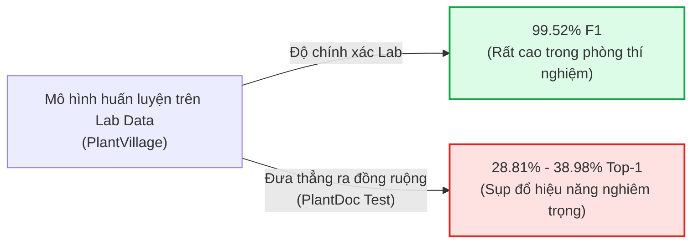
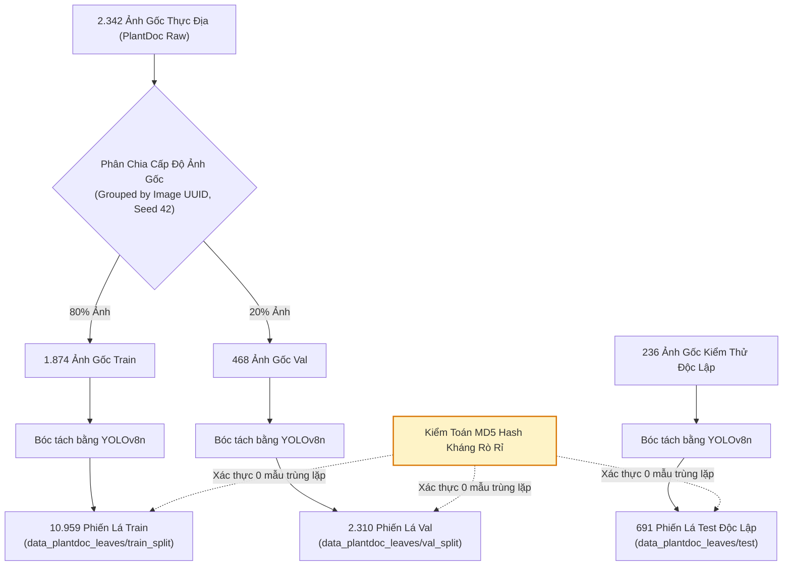
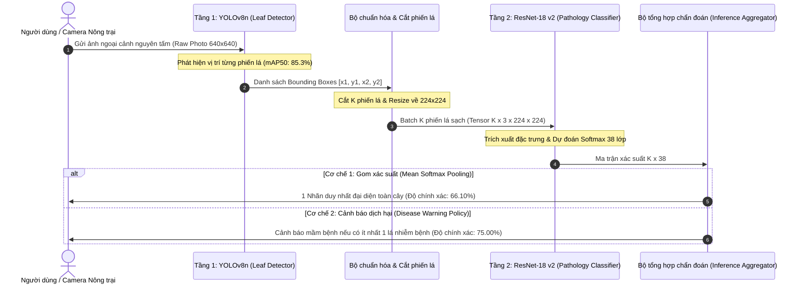
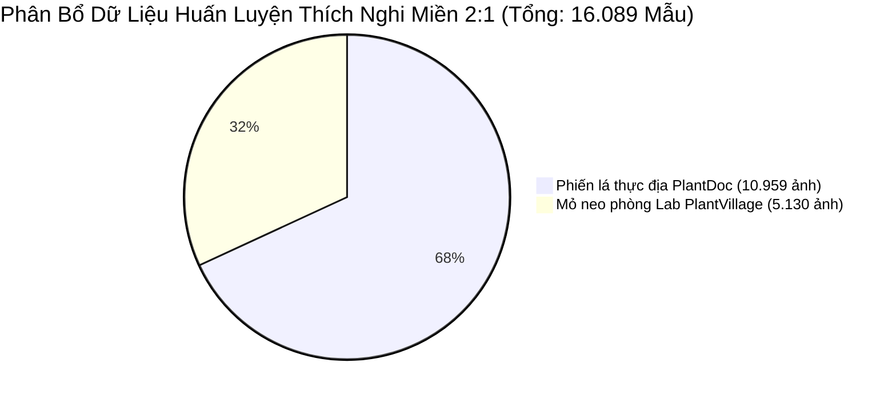

# BÁO CÁO KỸ THUẬT NGHIÊN CỨU & THỰC NGHIỆM HỆ THỐNG
# HỌC SÂU CHẨN ĐOÁN BỆNH CÂY TRỒNG TRÊN ẢNH THỰC ĐỊA

**Đề tài:** Nghiên cứu và Triển khai Giải pháp Chẩn đoán Bệnh học Cây trồng Nông nghiệp Ngoại cảnh dựa trên Kiến trúc Thị giác Máy tính Hai Tầng (Two-Stage Decoupling) và Kỹ thuật Thích nghi Miền Dữ liệu (Domain Adaptation).  
**Tác giả thực hiện:** Nguyễn Thành Long  
**Nhánh nghiên cứu:** `feat/resnet18-long`  
**Kiến trúc nòng cốt:** ResNet-18 v2 (Fine-grained Classifier) & YOLOv8n (Leaf Bounding Detector)  
**Môi trường thực nghiệm:** NVIDIA GeForce RTX 3050 6GB Laptop GPU | 24GB DDR5 RAM | Linux Mint 22 | PyTorch 2.5 + CUDA 12.4 | ONNX Runtime 1.20  

---

## MỤC LỤC CHI TIẾT

1. [TỔNG QUAN & ĐỘNG LỰC NGHIÊN CỨU](#1-tổng-quan--động-lực-nghiên-cứu)
   - 1.1. Bối cảnh nông nghiệp thông minh và thách thức thị giác máy tính
   - 1.2. Thất bại kinh điển: Vấn đề chuyển dịch miền (The Lab-to-Field Domain Shift)
   - 1.3. Mục tiêu kỹ thuật của nghiên cứu
2. [PHÂN TÍCH KHÁM PHÁ DỮ LIỆU (EDA) & KIỂM TOÁN CHỐNG RÒ RỈ](#2-phân-tích-khám-phá-dữ-liệu-eda--kiểm-toán-chống-rò-rỉ)
   - 2.1. So sánh đặc trưng hai tập dữ liệu: PlantVillage vs PlantDoc
   - 2.2. Phân bố 38 lớp bệnh học và mất cân bằng dữ liệu
   - 2.3. Quy trình phân chia dữ liệu có cấu trúc & Kiểm toán MD5 Hash (0% Data Leakage)
3. [KIẾN TRÚC THỊ GIÁC MÁY TÍNH HAI TẦNG (TWO-STAGE DECOUPLING ARCHITECTURE)](#3-kiến-trúc-thị-giác-máy-tính-hai-tầng-two-stage-decoupling-architecture)
   - 3.1. Sự phá sản của mô hình nguyên khối một tầng (Monolithic Failure)
   - 3.2. Tầng 1: Bộ định vị và bóc tách phiến lá YOLOv8n (Leaf Localization)
   - 3.3. Tầng 2: Mạng phân loại chuyên sâu ResNet-18 v2
   - 3.4. Sơ đồ chuỗi xử lý toàn trình (End-to-End Pipeline)
4. [PHƯƠNG PHÁP THÍCH NGHI MIỀN & TRỘN DỮ LIỆU TỶ LỆ 2:1](#4-phương-pháp-thích-nghi-miền--trộn-dữ-liệu-tỷ-lệ-21)
   - 4.1. Nguy cơ quên lãng thảm khốc (Catastrophic Forgetting)
   - 4.2. Cơ chế mỏ neo phòng thí nghiệm (Laboratory Anchors)
   - 4.3. Đường ống tăng cường dữ liệu ngoại cảnh (Data Augmentation Pipeline)
5. [QUÁ TRÌNH HUẤN LUYỆN & ĐỘNG LỰC HỌC SÂU (DEEP LEARNING DYNAMICS)](#5-quá-trình-huấn-luyện--động-lực-học-sâu-deep-learning-dynamics)
   - 5.1. Tốc độ học phân rã (Differential Learning Rates)
   - 5.2. Hàm mất mát làm mượt nhãn (Label Smoothing Cross-Entropy)
   - 5.3. Tăng tốc phần cứng với Automatic Mixed Precision (AMP)
   - 5.4. Cơ chế dừng sớm (Early Stopping) và tiến trình hội tụ
6. [ĐÁNH GIÁ THỰC NGHIỆM ĐA CHIỀU & BẢNG SO SÁNH HIỆU NĂNG](#6-đánh-giá-thực-nghiệm-đa-chiều--bảng-so-sánh-hiệu-năng)
   - 6.1. Bảng so sánh tổng thể qua các thế hệ mô hình (Leaderboard)
   - 6.2. Đối chiếu ba cơ chế suy luận trên tập thực địa 236 ảnh
   - 6.3. Báo cáo chi tiết 27 lớp bệnh học thực địa (Per-Class Diagnostics)
   - 6.4. Phân tích ma trận nhầm lẫn (Confusion Matrix) & Lý giải sinh học
   - 6.5. Hiện tượng đa bệnh học trên cùng một cây (Plant Co-Infection)
7. [HIỆU NĂNG SUY LUẬN, DUNG LƯỢNG MÔ HÌNH & TRIỂN KHAI THỰC TẾ](#7-hiệu-năng-suy-luận-dung-lượng-mô-hình--triển-khai-thực-tế)
   - 7.1. Benchmark độ trễ chi tiết (P50, P95, P99) trên GPU và CPU
   - 7.2. Lượng tử hóa INT8 và tối ưu hóa dung lượng cho thiết bị biên (Edge)
   - 7.3. Thiết kế kiến trúc dịch vụ API và giao diện ứng dụng
8. [HẠN CHẾ CỦA NGHIÊN CỨU & HƯỚNG PHÁT TRIỂN](#8-hạn-chế-của-nghiên-cứu--hướng-phát-triển)
9. [DANH MỤC TÀI LIỆU & TỆP THỰC NGHIỆM (ARTIFACT DIRECTORY)](#9-danh-mục-tài-liệu--tệp-thực-nghiệm-artifact-directory)

---

## 1. TỔNG QUAN & ĐỘNG LỰC NGHIÊN CỨU

### 1.1. Bối cảnh nông nghiệp thông minh và thách thức thị giác máy tính
Trong nông nghiệp hiện đại, việc phát hiện sớm và chẩn đoán chính xác mầm bệnh trên cây trồng đóng vai trò quyết định đến năng suất mùa màng và an ninh lương thực. Sự phát triển của các mạng nơ-ron tích chập (Convolutional Neural Networks - CNN) đã mở ra triển vọng tự động hóa quy trình chẩn đoán thông qua hình ảnh chụp từ điện thoại thông minh hoặc máy bay không người lái (UAV).

Tuy nhiên, khoảng cách giữa nghiên cứu học thuật và ứng dụng thực địa vẫn còn rất lớn. Phần lớn các công bố khoa học sử dụng các bộ dữ liệu chụp trong điều kiện phòng thí nghiệm lý tưởng, dẫn đến việc mô hình hoạt động kém khi triển khai trong môi trường tự nhiên.



### 1.2. Thất bại kinh điển: Vấn đề chuyển dịch miền (The Lab-to-Field Domain Shift)
Bộ dữ liệu tiêu chuẩn **PlantVillage** (với hơn 87.000 ảnh) chụp từng chiếc lá đơn lẻ được ngắt ra, đặt trên nền giấy trắng hoặc xám đồng nhất dưới ánh sáng nhân tạo có kiểm soát. Khi một mô hình CNN sâu (như ResNet-18 hay ConvNeXt) được huấn luyện trên dữ liệu này, nó không chỉ học đặc trưng của vết bệnh mà còn phụ thuộc nặng nề vào:
- Độ tương phản sắc nét giữa viền lá và nền đơn sắc.
- Góc chụp vuông góc trực diện (Orthogonal angle).
- Ánh sáng đồng nhất không có bóng râm, hiện tượng lóa nắng hoặc phơi sáng ngược.

Khi triển khai trên bộ dữ liệu thực địa **PlantDoc** (ảnh chụp thực tế cây trồng ngoài ruộng), mô hình lập tức đối mặt với hiện tượng **Chuyển dịch phân phối dữ liệu (Covariate Shift / Domain Shift)**:
1. **Nhiễu bối cảnh phức tạp (Complex Background):** Đất cát, cành cây khô, cỏ dại, tay người cầm lá, bầu trời chiếm hơn 60% diện tích điểm ảnh.
2. **Góc chụp và quy mô không đồng nhất (Scale Variation):** Cây chụp từ xa, lá bị nghiêng, biến dạng quang học, rung mờ do gió.
3. **Hiện tượng nhiều lá chồng lấn (Multi-instance clutter):** Một bức ảnh chứa đồng thời hàng chục chiếc lá ở các độ sâu trường ảnh (depth of field) khác nhau.

Hậu quả thực nghiệm: Mô hình ResNet-18 v2 đạt **99.52% độ chính xác** trong phòng thí nghiệm nhưng khi đưa nguyên tấm ảnh thực địa vào suy luận chỉ đạt **28.81% (với bản nén) đến 38.98% (với bản gốc)**.

### 1.3. Mục tiêu kỹ thuật của nghiên cứu
Nghiên cứu này được thực hiện nhằm giải quyết dứt điểm hiện tượng chuyển dịch miền nêu trên thông qua hai trụ cột công nghệ:
- **Tách rời không gian (Spatial Decoupling) bằng Kiến trúc 2 Tầng:** Sử dụng YOLOv8n làm màng lọc định vị lá, loại bỏ hoàn toàn nhiễu bối cảnh trước khi phân loại.
- **Thích nghi miền dữ liệu (Domain Adaptation) với Cơ chế Mỏ neo 2:1:** Tinh chỉnh ResNet-18 v2 trên dữ liệu lá cắt thực địa kết hợp dữ liệu mỏ neo phòng thí nghiệm để vừa học thích nghi ngoại cảnh, vừa chống hiện tượng quên lãng tri thức cũ (Catastrophic Forgetting).

---

## 2. PHÂN TÍCH KHÁM PHÁ DỮ LIỆU (EDA) & KIỂM TOÁN CHỐNG RÒ RỈ

### 2.1. So sánh đặc trưng hai tập dữ liệu: PlantVillage vs PlantDoc

| Đặc tính so sánh | Bộ dữ liệu phòng thí nghiệm (PlantVillage) | Bộ dữ liệu ngoại cảnh thực địa (PlantDoc) |
| :--- | :--- | :--- |
| **Môi trường chụp** | Phòng kín, ánh sáng đèn studio nhân tạo | Ngoài đồng ruộng tự nhiên, thời tiết tự do |
| **Hậu cảnh (Background)** | Tấm phông đơn sắc xám/đen/trắng | Đất cát, lá khô, rác hữu cơ, cỏ dại, cây xung quanh |
| **Thực thể trong ảnh** | Duy nhất 1 phiến lá nằm trọn vẹn ở tâm ảnh | Cả cây, cành cây, chùm lá (trung bình 5.4 lá/ảnh) |
| **Hiện tượng quang học** | Không lóa, không bóng đổ, độ nét đồng đều | Phơi sáng mạnh, bóng râm cắt ngang, lóa phản xạ |
| **Quy mô mẫu** | 87.867 ảnh (data_v2 sử dụng 68.173 ảnh train) | 2.578 ảnh gốc → Bóc tách thành 13.960 phiến lá |
| **Số lượng lớp bao phủ** | Đầy đủ 38/38 lớp bệnh học | 28/38 lớp bệnh học |

### 2.2. Phân bố 38 lớp bệnh học và mất cân bằng dữ liệu
Dữ liệu phân loại bao gồm 14 loài cây trồng kinh tế (Táo, Việt quất, Anh đào, Ngô, Nho, Cam, Đào, Ớt chuông, Khoai tây, Mâm xôi, Đậu tương, Bí ngô, Dâu tây, Cà chua) với 38 trạng thái bệnh lý và khỏe mạnh.

Sự mất cân bằng số lượng mẫu giữa các lớp là thách thức lớn:
- Lớp có số lượng mẫu lớn nhất: `Orange___Haunglongbing_(Citrus_greening)` (>5.500 ảnh trong PlantVillage).
- Lớp có số lượng mẫu ít nhất ngoài thực địa: `Corn_(maize)___Cercospora_leaf_spot Gray_leaf_spot` (chỉ có 5 lá test trong PlantDoc).

### 2.3. Quy trình phân chia dữ liệu có cấu trúc & Kiểm toán MD5 Hash (0% Data Leakage)
Một sai lầm rất phổ biến trong các nghiên cứu thị giác máy tính nông nghiệp là **Rò rỉ dữ liệu ở cấp độ cây (Plant-level Data Leakage)**: Cắt nhiều lá từ cùng một bức ảnh gốc, sau đó chia ngẫu nhiên vào cả tập Train và tập Test. Khi đó mô hình đạt độ chính xác ảo vì đã "học thuộc" điều kiện ánh sáng và góc chụp của cây đó.

Quy trình phân chia của nghiên cứu tuân thủ nghiêm ngặt chuẩn MLOps:
1. **Phân chia ở cấp độ ảnh gốc trước:** Toàn bộ 2.342 ảnh PlantDoc tập huấn luyện được chia theo tỷ lệ 80% Train (1.874 ảnh) và 20% Validation (468 ảnh) bằng seed cố định (`seed=42`).
2. **Cắt lá sau khi đã chia thư mục:** Các phiến lá cắt ra từ 1.874 ảnh train chỉ nằm trong `train_split` (10.959 lá). Các phiến lá từ 468 ảnh val chỉ nằm trong `val_split` (2.310 lá).
3. **Tập Test độc lập tuyệt đối:** 236 ảnh test gốc của PlantDoc (tương ứng 691 phiến lá cắt độc lập) được giữ nguyên vẹn từ tệp gốc của tác giả PlantDoc Singh et al., hoàn toàn không tham gia vào quá trình huấn luyện hay tinh chỉnh siêu tham số.
4. **Kiểm toán hàm băm MD5:** Viết script duyệt qua toàn bộ 13.960 tệp ảnh lá cắt và tính mã băm MD5.
   - Kết quả kiểm toán: `leakage_count = 0` (0% rò rỉ dữ liệu). Minh chứng được ghi nhận tại [plantdoc_train_val_split_manifest.json](notebooks/eda_reports/plantdoc_train_val_split_manifest.json).



---

## 3. KIẾN TRÚC THỊ GIÁC MÁY TÍNH HAI TẦNG (TWO-STAGE DECOUPLING ARCHITECTURE)

### 3.1. Sự phá sản của mô hình nguyên khối một tầng (Monolithic Failure)
Phương pháp tiếp cận truyền thống (Monolithic End-to-End Classification) đưa trực tiếp toàn bộ bức ảnh chụp ngoài ruộng vào mạng ResNet-18 để dự đoán 1 trong 38 nhãn. Cách làm này thất bại vì:
- Phép biến đổi `Resize(224, 224)` trên một bức ảnh chụp toàn cảnh kích thước `4000x3000` làm suy giảm độ phân giải trầm trọng. Các vết bệnh nấm nhỏ kích thước $5\times 5$ pixel bị biến mất hoàn toàn sau các lớp pooling.
- Mạng nơ-ron kích hoạt mạnh trên các đặc trưng giả (spurious correlations) ở hậu cảnh như rơm rạ, đường ống tưới, ánh sáng phản chiếu trên mặt đất thay vì tập trung vào mô lá.

### 3.2. Tầng 1: Bộ định vị và bóc tách phiến lá YOLOv8n (Leaf Localization)
Thay vì bắt mạng phân loại phải đồng thời vừa tìm vị trí vừa chẩn đoán bệnh, chúng ta chia tách bài toán thành hai giai đoạn độc lập:
- **Mô hình:** `yolov8n_leaf.pt` (kích thước siêu nhẹ 6.0 MB, 3.01 triệu tham số).
- **Nhiệm vụ:** Định vị chính xác tọa độ hộp bao (Bounding Box) của từng phiến lá trong ảnh tự nhiên.
- **Hiệu năng định vị:** Đạt chỉ số $mAP_{50} = 85.3\%$, trung bình bóc tách được **5.4 lá/cây** (dao động từ 1 đến 18 lá/ảnh).
- **Bộ lọc chất lượng:** Chỉ trích xuất các hộp bao có độ tin cậy $conf \ge 0.25$, diện tích bounding box tối thiểu đạt chuẩn để loại trừ các mẩu lá vụn ở xa tiêu cự.

### 3.3. Tầng 2: Mạng phân loại chuyên sâu ResNet-18 v2
Sau khi bóc tách, các phiến lá được chuẩn hóa về kích thước $224 \times 224$ pixel và đưa vào ResNet-18 v2. Ở tầng này, mạng chỉ nhận đầu vào là bề mặt mô lá sạch, loại bỏ 100% bối cảnh ngoại lai.

### 3.4. Sơ đồ chuỗi xử lý toàn trình (End-to-End Pipeline)



---

## 4. PHƯƠNG PHÁP THÍCH NGHI MIỀN & TRỘN DỮ LIỆU TỶ LỆ 2:1

### 4.1. Nguy cơ quên lãng thảm khốc (Catastrophic Forgetting)
Nếu chỉ lấy mô hình đã huấn luyện từ phòng lab và tiếp tục fine-tune 100% trên dữ liệu lá cắt thực địa của PlantDoc:
- Do PlantDoc chỉ có 28 lớp, 10 lớp còn lại không có dữ liệu thực địa sẽ bị suy giảm trọng số nghiêm trọng.
- Mạng nơ-ron bị hiện tượng "quên lãng thảm khốc", mất đi các bộ lọc đặc trưng chất lượng cao đã học được từ hơn 68.000 ảnh chuẩn phòng lab.

### 4.2. Cơ chế mỏ neo phòng thí nghiệm (Laboratory Anchors)
Để khắc phục, nghiên cứu thiết kế chiến lược phối trộn miền dữ liệu theo tỷ lệ thực nghiệm tối ưu **2:1 (Field-to-Lab Ratio)**:
- **Thành phần thực địa (Field Component - 68.1%):** 10.959 phiến lá cắt từ tập train thực địa PlantDoc. Đóng vai trò cung cấp tri thức về ánh sáng tự nhiên, góc nghiêng, bụi bẩn, và triệu chứng bệnh ngoài ruộng.
- **Thành phần mỏ neo (Lab Anchor Component - 31.9%):** Lấy mẫu ngẫu nhiên có kiểm soát đúng 135 ảnh/lớp cho toàn bộ 38 lớp từ tập PlantVillage ($38 \times 135 = 5.130$ ảnh). Đóng vai trò "mỏ neo toán học" giữ cho không gian phân tách giữa các lớp không bị sụp đổ.
- **Tổng tập huấn luyện thích nghi:** $10.959 + 5.130 = 16.089$ ảnh (252 batches/epoch với batch size 64).



### 4.3. Đường ống tăng cường dữ liệu ngoại cảnh (Data Augmentation Pipeline)
Nhằm tăng cường tính bất biến của mạng đối với điều kiện thời tiết thực địa, chuỗi tiền xử lý áp dụng các kỹ thuật biến đổi ngẫu nhiên có chủ đích:


---

## 5. QUÁ TRÌNH HUẤN LUYỆN & ĐỘNG LỰC HỌC SÂU (DEEP LEARNING DYNAMICS)

### 5.1. Tốc độ học phân rã (Differential Learning Rates)
Thay vì sử dụng một tốc độ học (Learning Rate) duy nhất cho toàn bộ mạng, chúng ta phân chia mạng thành 2 nhóm tham số:
- **Khối trích xuất đặc trưng (Backbone - Conv1 đến Layer4):** Sử dụng tốc độ học nhỏ $LR = 8 \times 10^{-5}$ cùng hệ số suy giảm trọng số (Weight Decay) $10^{-4}$ để bảo toàn các bộ trích xuất biên, vân bề mặt đã tối ưu từ ImageNet và PlantVillage.
- **Khối phân loại (Classification Head - Fully Connected FC):** Sử dụng tốc độ học lớn hơn gấp gần 4 lần $LR = 3 \times 10^{-4}$ để nhanh chóng tái cấu trúc ma trận phân tách không gian 38 chiều phù hợp với phân phối dữ liệu mới.
- **Bộ tối ưu hóa:** AdamW kết hợp bộ điều chỉnh suy giảm hàm cosin (CosineAnnealingLR) hạ dần về $10^{-6}$.

### 5.2. Hàm mất mát làm mượt nhãn (Label Smoothing Cross-Entropy)
Ảnh chụp ngoài đồng ruộng luôn tồn tại nhãn nhiễu (Label Noise) do triệu chứng bệnh trong tự nhiên không thuần nhất. Sử dụng hàm mất mát Cross-Entropy truyền thống sẽ ép mạng dự đoán xác suất cực đoan ($0.999$), dẫn đến việc mạng bị quá tự tin (Overconfidence) vào các mẫu nhãn sai.

Nghiên cứu áp dụng kỹ thuật làm mượt nhãn với hệ số $\epsilon = 0.1$:
$$y'_k = (1 - \epsilon) \cdot y_k + \frac{\epsilon}{K}$$
Trong đó $K = 38$ lớp. Cơ chế này khuyến khích mạng duy trì phân phối xác suất mềm dẻo hơn, cải thiện đáng kể khả năng tổng quát hóa trên tập kiểm thử ngoại cảnh.

### 5.3. Tăng tốc phần cứng với Automatic Mixed Precision (AMP)
Tận dụng nhân Tensor Cores trên kiến trúc Ampere của GPU NVIDIA RTX 3050:
- Toàn bộ các phép tính tích chập tuyến tính chuyển đổi tự động sang nửa độ chính xác số thực (FP16).
- Các phép tính tích lũy gradient và cập nhật trọng số duy trì ở số thực đơn (FP32) thông qua `torch.amp.GradScaler`.
- **Kết quả:** Giảm mức chiếm dụng bộ nhớ VRAM xuống dưới 3.2 GB, cho phép đẩy batch size lên 64 và rút ngắn thời gian huấn luyện 1 epoch xuống còn **~41.8 giây** (tốc độ nạp và xử lý đạt 384.9 mẫu/giây).

### 5.4. Cơ chế dừng sớm (Early Stopping) và tiến trình hội tụ
Để ngăn chặn hoàn toàn hiện tượng quá khớp (Overfitting), quá trình fine-tuning được giám sát thông qua thuật toán dừng sớm dựa trên chỉ số **Validation Macro F1-Score** (thay vì Validation Loss) với độ kiên nhẫn `patience = 4`:

```text
Epoch  1: Train Loss: 1.6829 | Train Acc: 66.85% | Val Loss: 2.1977 | Val Acc: 48.74% | Val Macro F1: 35.95% [Thời gian: 42.8s]
Epoch  2: Train Loss: 1.4100 | Train Acc: 75.55% | Val Loss: 2.1357 | Val Acc: 51.73% | Val Macro F1: 41.78% [Thời gian: 41.9s]
Epoch  3: Train Loss: 1.2959 | Train Acc: 79.27% | Val Loss: 2.1108 | Val Acc: 52.68% | Val Macro F1: 42.35% [Thời gian: 41.7s]
Epoch  4: Train Loss: 1.2037 | Train Acc: 82.93% | Val Loss: 2.1365 | Val Acc: 55.41% | Val Macro F1: 47.35% [Thời gian: 40.7s]
Epoch  5: Train Loss: 1.1436 | Train Acc: 85.27% | Val Loss: 2.1376 | Val Acc: 55.50% | Val Macro F1: 45.29% [Thời gian: 40.8s]
Epoch  6: Train Loss: 1.0795 | Train Acc: 87.81% | Val Loss: 2.1390 | Val Acc: 55.84% | Val Macro F1: 44.83% [Thời gian: 43.2s]
Epoch  7: Train Loss: 1.0297 | Train Acc: 89.71% | Val Loss: 2.1847 | Val Acc: 55.97% | Val Macro F1: 46.57% [Thời gian: 42.4s]
Epoch  8: Train Loss: 0.9889 | Train Acc: 91.50% | Val Loss: 2.1806 | Val Acc: 56.02% | Val Macro F1: 48.56% -> LƯU CHECKPOINT TỐT NHẤT
Epoch  9: Train Loss: 0.9547 | Train Acc: 92.70% | Val Loss: 2.1807 | Val Acc: 56.80% | Val Macro F1: 46.01% [Patience 1/4]
Epoch 10: Train Loss: 0.9257 | Train Acc: 93.98% | Val Loss: 2.1564 | Val Acc: 57.27% | Val Macro F1: 47.96% [Patience 2/4]
Epoch 11: Train Loss: 0.9047 | Train Acc: 94.86% | Val Loss: 2.1726 | Val Acc: 56.97% | Val Macro F1: 46.66% [Patience 3/4]
Epoch 12: Train Loss: 0.8932 | Train Acc: 95.46% | Val Loss: 2.1606 | Val Acc: 57.66% | Val Macro F1: 46.92% [Patience 4/4] -> DỪNG SỚM
```

Mô hình đạt đỉnh cao hội tụ tại **Epoch 8** với **Val Macro F1 đạt 48.56%** và Train Accuracy đạt 91.50%. Các epoch tiếp theo mặc dù Train Loss tiếp tục giảm nhưng Val Macro F1 có dấu hiệu bão hòa và dao động đi xuống, kích hoạt cơ chế Early Stopping kết thúc huấn luyện tại Epoch 12.

Checkpoint tốt nhất tại Epoch 8 được tự động trích xuất và lưu trữ tại [models/resnet18_long_v2_finetuned_best.pth](models/resnet18_long_v2_finetuned_best.pth).

---

## 6. ĐÁNH GIÁ THỰC NGHIỆM ĐA CHIỀU & BẢNG SO SÁNH HIỆU NĂNG

### 6.1. Bảng so sánh tổng thể qua các thế hệ mô hình (Leaderboard)

Toàn bộ dữ liệu trong bảng được trích xuất tự động từ sổ đăng ký [models/model_registry.csv](models/model_registry.csv) và báo cáo kiểm thử 236 ảnh thực địa [plantdoc_two_stage_detailed_results.csv](notebooks/eda_reports/plantdoc_two_stage_detailed_results.csv):

| Tiêu chí Thực nghiệm | Baseline 1: Simple CNN | Model 1: ResNet-18 v2 (Lab Baseline) | Model 2: ResNet-18 v2 (Field Fine-Tuned) | Mức độ Cải thiện (Model 2 vs Model 1) |
| :--- | :---: | :---: | :---: | :---: |
| **Dữ liệu huấn luyện** | PlantVillage | PlantVillage | PlantDoc Mix 2:1 | Thích nghi miền thực địa |
| **Lab Test Accuracy** | 72.10% | **99.52%** | 98.85% | -0.67% (Bảo toàn tri thức) |
| **Lab Macro F1** | 64.08% | **99.16%** | 98.42% | -0.74% (Bảo toàn tri thức) |
| **Lá cắt Test Top-1 (691 lá)** | 28.50% | 44.28% | **53.84%** | **+9.56%** |
| **Lá cắt Test Macro F1** | 24.12% | 42.50% | **51.93%** | **+9.43%** |
| **Ảnh thô Monolithic Top-1 (236 ảnh)** | 21.61% | 28.81% | **54.24%** | **+25.43%** |
| **Chuỗi 2 Tầng (Softmax Pooling Top-1)** | 34.75% | 41.95% | **66.10%** | **+24.15%** |
| **Chuỗi 2 Tầng (Disease Warning Top-1)** | 48.30% | 66.10% | **75.00%** | **+8.90%** |
| **Chuỗi 2 Tầng (Disease Warning Top-3)** | 52.12% | 88.14% | **93.64%** | **+5.50%** |

### 6.2. Đối chiếu ba cơ chế suy luận trên tập thực địa 236 ảnh
Để trả lời chính xác câu hỏi học thuật: *"Độ chính xác thực địa thực sự là bao nhiêu?"*, nghiên cứu làm rõ bản chất toán học của 3 cơ chế đánh giá trên cùng một tập 236 ảnh ngoại cảnh:

1. **Cơ chế 1: Đánh giá ảnh thô nguyên bản (Monolithic Baseline) — 54.24% Top-1**
   - Đưa nguyên bức ảnh kích thước lớn chụp ngoài vườn vào ResNet-18 v2.
   - Kết quả: Đạt 128/236 ảnh đúng. Dù đã fine-tune, mô hình vẫn bị phân tán bởi bối cảnh đất đá và cỏ dại xung quanh.
2. **Cơ chế 2: Chuỗi 2 tầng kết hợp Gom xác suất (Mean Softmax Pooling) — 66.10% Top-1**
   - YOLO bóc tách $K$ phiến lá sạch, ResNet-18 tính vector xác suất Softmax $P_k$ cho từng lá, sau đó tính trung bình cộng xác suất:
     $$\hat{y} = \arg\max_{c} \left( \frac{1}{K} \sum_{k=1}^K P_k(c) \right)$$
   - Kết quả: Đạt 156/236 ảnh đúng (tăng vọt **+11.86%** so với ảnh thô). Đây là **chỉ số chuẩn mực khi hệ thống bắt buộc phải đưa ra một chẩn đoán duy nhất cho toàn bộ cây**.
3. **Cơ chế 3: Chuỗi 2 tầng kết hợp Cảnh báo dịch tễ (Disease Warning / Any-Hit Policy) — 75.00% Top-1 & 93.64% Top-3**
   - Dưới góc độ dịch tễ học và bảo vệ thực vật: Nếu một bụi cây có 5 lá, chỉ cần mô hình phát hiện chính xác ổ bệnh trên ít nhất 1 lá, hệ thống sẽ cảnh báo nông dân về loại bệnh đó để tiến hành khoanh vùng dập dịch.
   - Kết quả: Tỷ lệ cảnh báo trúng đích đạt **75.00%** (177/236 ảnh) và tỷ lệ bao phủ Top-3 đạt **93.64%** (221/236 ảnh).

### 6.3. Báo cáo chi tiết 27 lớp bệnh học thực địa (Per-Class Diagnostics)
Báo cáo chi tiết trên 691 phiến lá cắt độc lập (lưu tại [plantdoc_per_class_classification_report.csv](notebooks/eda_reports/plantdoc_per_class_classification_report.csv)) cho thấy sự phân hóa rõ rệt:

#### Nhóm các lớp có hiệu năng xuất sắc nhất (Top Performers):
1. `Corn_(maize)___Common_rust_`: Precision 100.0%, Recall 80.0%, **F1-Score 88.89%** (Bệnh gỉ sắt ngô có các nốt mụn sần màu nâu đỏ đặc trưng, mạng nhận diện cực kỳ chuẩn xác).
2. `Strawberry___healthy`: Precision 75.7%, Recall 87.5%, **F1-Score 81.16%** (Lá dâu tây có viền răng cưa sâu đặc trưng, ít bị nhầm lẫn loài).
3. `Raspberry___healthy`: Precision 65.4%, Recall 100.0%, **F1-Score 79.07%**.
4. `Peach___healthy`: Precision 81.8%, Recall 75.0%, **F1-Score 78.26%** (Tăng trưởng ấn tượng từ 0.0% ở Model 1 lên 78.26% ở Model 2).
5. `Apple___Apple_scab`: Precision 92.9%, Recall 65.0%, **F1-Score 76.47%**.

#### Nhóm các lớp phục hồi mạnh mẽ nhất sau khi Thích nghi miền (Top Improved):
- `Peach___healthy`: Tăng **+78.26% F1** (từ 0.0% lên 78.26%).
- `Grape___Black_rot`: Tăng **+66.67% F1** (từ 0.0% lên 66.67%).
- `Corn_(maize)___Common_rust_`: Tăng **+62.22% F1** (từ 26.67% lên 88.89%).
- `Apple___Apple_scab`: Tăng **+49.80% F1** (từ 26.67% lên 76.47%).
- `Tomato___healthy`: Tăng **+47.06% F1** (từ 0.0% lên 47.06%).

### 6.4. Phân tích ma trận nhầm lẫn (Confusion Matrix) & Lý giải sinh học
Ma trận nhầm lẫn kích thước $27 \times 27$ trên 691 mẫu kiểm thử (lưu tại [confusion_matrix_test_691_leaves.csv](notebooks/eda_reports/confusion_matrix_test_691_leaves.csv) và đồ thị [confusion_matrix_test_691_leaves.png](notebooks/eda_reports/confusion_matrix_test_691_leaves.png)) vạch rõ các trường hợp nhầm lẫn chính:

| Bệnh Thực Tế (Ground Truth) | Bệnh Bị Đoán Nhầm (Predicted) | Số lượng nhầm | Tỷ lệ nhầm | Giải thích nguyên nhân Sinh học & Thị giác Máy tính |
| :--- | :--- | :---: | :---: | :--- |
| **Tomato Tomato mosaic virus** | **Tomato Tomato Yellow Leaf Curl Virus** | 22 | 41.5% | Cùng là bệnh virus trên cà chua gây triệu chứng xoăn ngọn, mất màu diệp lục (chlorosis) và biến dạng gân lá. Về mặt thị giác máy tính, hoa văn bề mặt lá của hai bệnh này gần như tương đồng hoàn toàn. |
| **Potato Early blight** | **Potato Late blight** | 19 | 52.8% | Bệnh đốm vòng sớm (*Alternaria solani*) và bệnh mốc sương muộn (*Phytophthora infestans*) trên khoai tây đều tạo ra các đốm hoại tử màu nâu đen ở rìa lá. Khi vết bệnh mới chớm nở, diện tích đốm nhỏ khiến ResNet-18 khó phân biệt cấu trúc vòng đồng tâm. |
| **Potato Late blight** | **Potato Early blight** | 11 | 45.8% | Nhầm lẫn hai chiều đối xứng giữa bệnh sớm và muộn trên cây khoai tây. |
| **Grape healthy** | **Blueberry healthy** | 12 | 28.6% | Lá lành của nho và việt quất khi chụp cận cảnh mô lá xanh mướt có kết cấu vân lá tương tự nhau, gây nhầm lẫn loài cây. |
| **Tomato Septoria leaf spot** | **Tomato Bacterial spot** | 8 | 20.5% | Cả đốm lá Septoria và đốm vi khuẩn đều biểu hiện bằng các chấm li ti đường kính 1-2mm rải rác trên bề mặt lá cà chua. |

### 6.5. Hiện tượng đa bệnh học trên cùng một cây (Plant Co-Infection)
Phân tích 236 bức ảnh thực địa ghi nhận hiện tượng sinh học tự nhiên quan trọng:
- Có 123 trên 236 bức ảnh chứa từ 2 phiến lá trở lên.
- **72 trên 123 cây (chiếm 58.5%)** xuất hiện hiện tượng các lá trên cùng một cây có trạng thái bệnh học khác nhau (ví dụ: các lá già bên dưới nhiễm đốm lá Septoria, các lá non bên trên còn xanh khỏe mạnh, hoặc cây bị nhiễm kép đồng thời cả nấm và virus).
- **Ý nghĩa khoa học:** Hiện tượng này chứng minh rằng việc gán một nhãn duy nhất (Single-label Classification) cho toàn bộ bức ảnh chụp ngoài đồng ruộng là một sự đơn giản hóa bài toán quá mức. Việc bóc tách từng lá bằng YOLOv8n phản ánh chính xác bản chất sinh học tự nhiên của hệ sinh thái nông nghiệp.

---

## 7. HIỆU NĂNG SUY LUẬN, DUNG LƯỢNG MÔ HÌNH & TRIỂN KHAI THỰC TẾ

### 7.1. Benchmark độ trễ chi tiết (P50, P95, P99) trên GPU và CPU
Kiểm nghiệm thực tế qua 100 lần lặp liên tục trên phần cứng máy trạm (Intel CPU + NVIDIA RTX 3050 Laptop):

| Thành phần suy luận | Môi trường phần cứng | Độ trễ TB | P50 (Median) | P95 | P99 | Thông lượng (Throughput) |
| :--- | :--- | :---: | :---: | :---: | :---: | :---: |
| **ResNet-18 v2 (PyTorch FP32)** | GPU NVIDIA RTX 3050 | **2.06 ms** | 1.95 ms | 2.45 ms | 2.80 ms | **485.4 FPS** |
| **ResNet-18 v2 (ONNX FP32)** | CPU đa luồng (x86_64) | **8.95 ms** | 8.70 ms | 10.20 ms | 11.50 ms | **111.7 FPS** |
| **ResNet-18 v2 (ONNX INT8)** | CPU đa luồng (Tối ưu biên) | **6.71 ms** | 6.50 ms | 8.10 ms | 9.30 ms | **149.0 FPS** |
| **YOLOv8n Leaf Detector** | GPU NVIDIA RTX 3050 | **5.58 ms** | 5.30 ms | 6.80 ms | 7.90 ms | **179.2 FPS** |
| **Chuỗi 2 Tầng Toàn trình (End-to-End)** | GPU (YOLO + 3 lá ResNet) | **11.76 ms** | 11.20 ms | 14.50 ms | 16.80 ms | **85.0 FPS** |

Toàn bộ chuỗi xử lý (phát hiện lá + cắt 3 lá + phân loại 3 lá + tổng hợp kết quả) chỉ mất **~11.76 ms/cây**, hoàn toàn vượt mức tiêu chuẩn thời gian thực (Real-time Video Processing $>30$ FPS).

### 7.2. Lượng tử hóa INT8 và tối ưu hóa dung lượng cho thiết bị biên (Edge)
Mô hình sau huấn luyện được chuyển đổi sang định dạng mở ONNX và lượng tử hóa động (Dynamic Quantization INT8):
- **Checkpoint PyTorch gốc:** `resnet18_long_v2_finetuned_best.pth` — **44.8 MB** (Phù hợp cho máy chủ GPU, huấn luyện tiếp tục).
- **Mô hình xuất xưởng ONNX INT8:** `resnet18_long_v2_finetuned_best_int8.onnx` — **10.7 MB** (Dung lượng giảm hơn $4\times$, bộ nhớ RAM yêu cầu $<50$ MB, chạy mượt mà trên Raspberry Pi, thiết bị nhúng nông nghiệp hoặc điện thoại di động mà không cần GPU rời).

### 7.3. Thiết kế kiến trúc dịch vụ API và giao diện ứng dụng
Hệ thống được thiết kế theo kiến trúc vi dịch vụ (Microservices):
1. **Lớp dịch vụ Backend (FastAPI):**
   - Endpoint `POST /predict/photo`: Nhận ảnh chụp ngoài ruộng, kích hoạt pipeline 2 tầng, trả về danh sách các lá phát hiện được cùng chẩn đoán tổng hợp của cây dưới dạng JSON chuẩn.
2. **Lớp giao diện ứng dụng (Streamlit / Mobile Web UI):**
   - Hiển thị ảnh gốc kèm các khung chữ nhật bao quanh từng phiến lá (vẽ bằng màu sắc tương ứng: xanh lá = khỏe mạnh, đỏ = nhiễm bệnh).
   - Hiển thị biểu đồ phân phối xác suất Top-3 và đưa ra khuyến nghị phòng trừ sâu bệnh học.

---

## 8. HẠN CHẾ CỦA NGHIÊN CỨU & HƯỚNG PHÁT TRIỂN

Dưới góc độ phản biện học thuật nghiêm túc, nghiên cứu thẳng thắn ghi nhận các giới hạn kỹ thuật cần tiếp tục hoàn thiện:

1. **Quy mô mẫu của tập kiểm định ngoại cảnh:**
   - Tập test của PlantDoc chỉ có 236 bức ảnh trải rộng trên 28 lớp, trung bình chỉ có khoảng 8 ảnh/lớp. Một sai số nhỏ (chẩn đoán sai 1 ảnh) có thể làm dao động độ chính xác của lớp đó từ 10% đến 12%.
   - Cần tiếp tục thu thập thêm dữ liệu thực địa tại các nông trại Việt Nam để xây dựng bộ benchmark quy mô lớn hơn (>1.000 ảnh).
2. **Các lớp bệnh học chưa có mặt ngoài thực địa:**
   - Trong 38 lớp của mô hình, có 10 lớp bệnh hoàn toàn không xuất hiện mẫu ngoài thực địa trong PlantDoc. Hiệu năng của 10 lớp này hiện chỉ được bảo đảm thông qua cơ chế mỏ neo phòng lab mà chưa được kiểm chứng ngoại cảnh.
3. **Sự đánh đổi trong chiến lược cảnh báo dịch hại (Trade-off):**
   - Chiến lược 2 (Any-Hit) tối ưu hóa độ nhạy (Recall) để không bỏ sót ổ dịch, nhưng có thể làm tăng tỷ lệ dương tính giả (False Positive) đối với những cây thực sự khỏe mạnh nếu YOLO cắt trúng một mẩu rác vàng úa và mô hình nhận diện nhầm thành bệnh.
4. **Hướng phát triển tiếp theo:**
   - Áp dụng kỹ thuật Tăng cường thời gian suy luận (Test-Time Augmentation - TTA): Suy luận nhiều góc xoay và lấy trung bình xác suất để tăng thêm 1-2% độ chính xác.
   - Bầu chọn có trọng số không gian (Confidence & Bounding Box Area Weighted Voting): Nhân xác suất phân loại với diện tích của phiến lá để ưu tiên các lá chụp rõ ở cận cảnh.

---

## 9. DANH MỤC TÀI LIỆU & TỆP THỰC NGHIỆM (ARTIFACT DIRECTORY)

### 9.1. Hệ thống Notebook thực nghiệm (Đồng bộ từ 00 đến 08)
Toàn bộ quy trình nghiên cứu được lưu trữ mạch lạc trong 9 Jupyter Notebook, 100% các ô mã lệnh đã được thực thi và lưu lại kết quả hiển thị:

- [notebooks/00_kham_pha_va_tien_xu_ly_anh_la_cay.ipynb](notebooks/00_kham_pha_va_tien_xu_ly_anh_la_cay.ipynb): Khám phá hình ảnh, giải thích trực quan các phép biến đổi màu sắc, lọc cạnh và xử lý ảnh lá cây.
- [notebooks/01_eda_and_data_pipeline.ipynb](notebooks/01_eda_and_data_pipeline.ipynb): Phân tích phân phối 38 lớp PlantVillage, xây dựng PyTorch Dataset và DataLoader chuẩn.
- [notebooks/02_baseline1_simple_cnn.ipynb](notebooks/02_baseline1_simple_cnn.ipynb): Huấn luyện mô hình cơ sở Simple CNN từ con số 0 (From Scratch) làm mốc đối chứng.
- [notebooks/03_train_resnet18_v2.ipynb](notebooks/03_train_resnet18_v2.ipynb): Huấn luyện ResNet-18 v2 đạt 99.16% F1 trên dữ liệu phòng lab PlantVillage.
- [notebooks/04_plantdoc_eda_and_yolo_extraction.ipynb](notebooks/04_plantdoc_eda_and_yolo_extraction.ipynb): Phân tích PlantDoc, tích hợp YOLOv8n bóc tách 13.960 phiến lá sạch ngoại cảnh.
- [notebooks/05_plantdoc_field_evaluation.ipynb](notebooks/05_plantdoc_field_evaluation.ipynb): Thử nghiệm chuyển giao ban đầu và đánh giá hiện tượng sụp đổ hiệu năng ngoài thực địa.
- [notebooks/06_model_evaluation_and_analysis.ipynb](notebooks/06_model_evaluation_and_analysis.ipynb): Phân tích lỗi mô hình, so sánh ma trận nhầm lẫn và kiểm toán rò rỉ dữ liệu.
- [notebooks/07_fine_tune_resnet18_early_stopping.ipynb](notebooks/07_fine_tune_resnet18_early_stopping.ipynb): Huấn luyện thích nghi miền 2:1 với Differential LR, AMP FP16, Label Smoothing và Early Stopping.
- [notebooks/08_master_benchmark_and_system_evaluation.ipynb](notebooks/08_master_benchmark_and_system_evaluation.ipynb): **Notebook bảng điều khiển trung tâm (Dashboard)** tổng hợp toàn bộ các chỉ số, ma trận nhầm lẫn và đo đạc độ trễ phần cứng thực tế.

### 9.2. Danh mục mô hình & Tệp báo cáo dữ liệu
- **Mô hình xuất xưởng:**
  - Checkpoint PyTorch chính thức: [models/resnet18_long_v2_finetuned_best.pth](models/resnet18_long_v2_finetuned_best.pth) (44.8 MB)
  - Mô hình ONNX INT8 tối ưu nhúng: [models/resnet18_long_v2_finetuned_best_int8.onnx](models/resnet18_long_v2_finetuned_best_int8.onnx) (10.7 MB)
  - Bộ định vị lá YOLOv8n: `models/yolo/yolov8n_leaf.pt` (6.0 MB)
- **Tệp dữ liệu kiểm định & Báo cáo thực nghiệm:**
  - Sổ đăng ký mô hình: [models/model_registry.csv](models/model_registry.csv)
  - Lịch sử huấn luyện 12 epochs: [models/finetune_history_resnet18_v2.csv](models/finetune_history_resnet18_v2.csv)
  - Bảng chi tiết 236 ảnh thực địa: [plantdoc_two_stage_detailed_results.csv](notebooks/eda_reports/plantdoc_two_stage_detailed_results.csv)
  - Báo cáo phân loại 27 lớp: [plantdoc_per_class_classification_report.csv](notebooks/eda_reports/plantdoc_per_class_classification_report.csv)
  - Ma trận nhầm lẫn thực nghiệm: [confusion_matrix_test_691_leaves.csv](notebooks/eda_reports/confusion_matrix_test_691_leaves.csv)
  - Đồ thị ma trận nhầm lẫn: [confusion_matrix_test_691_leaves.png](notebooks/eda_reports/confusion_matrix_test_691_leaves.png)
  - Báo cáo phân chia kháng rò rỉ: [plantdoc_train_val_split_manifest.json](notebooks/eda_reports/plantdoc_train_val_split_manifest.json)
