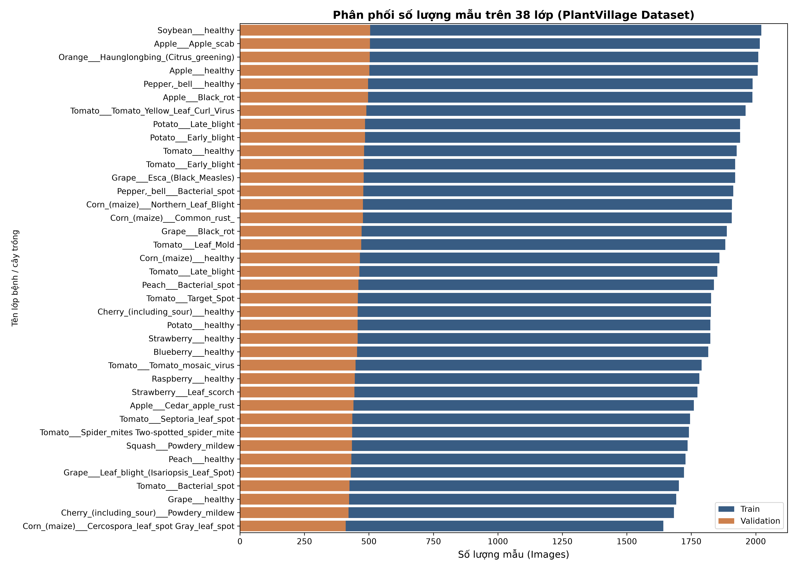

# 🌿 Plant Disease Classification — Chẩn Đoán Bệnh Lá Cây Nông Nghiệp

Hệ thống học sâu (Deep Learning) nhận diện **38 loại cây trồng & bệnh lý** từ ảnh chụp lá cây (bộ dữ liệu **PlantVillage**, 87.867 ảnh), được thiết kế chuẩn mực theo **Kiến trúc 3 tầng độc lập (3-Tier Decoupled Architecture)**, kết hợp **ConvNeXt-Tiny Fine-tuning (đạt 99.95% Val Macro-F1)**, **ONNX + INT8 Quantization (Dynamic & Static)** và **Rust (`axum` + `ort` + `rayon`)** để tối ưu toàn diện từ kiểm định dữ liệu đến phục vụ suy luận (Model Serving).

---

## 1. Giới thiệu bài toán

### 1.1. Bối cảnh & Mục tiêu
- **Bài toán:** Phân loại đa lớp (*Multi-class Image Classification*) với **38 lớp** gồm nhiều loại cây trồng (Táo, Cà chua, Khoai tây, Ngô, Nho, Cam, Ớt chuông, Đậu tương, Đào, Dâu tây...) ở cả trạng thái khỏe mạnh (`healthy`) và nhiễm bệnh (đốm lá, phấn trắng, sương mai, gỉ sắt, virus xoăn lá...).
- **Đầu vào:** Ảnh lá cây định dạng JPG/PNG (tự động đưa về kích thước chuẩn `224 × 224` RGB).
- **Đầu ra:** Nhãn bệnh có xác suất cao nhất (`predicted_class`), độ tin cậy (`confidence`), **Top-3** chẩn đoán kèm xác suất và độ trễ suy luận thực tế (`inference_time_ms`).
- **Tiêu chí đánh giá kép** (tham khảo *Designing Machine Learning Systems* — Chip Huyen, Chương 4 & 7):
  - **Chất lượng mô hình (ML Metrics):** **Macro F1-Score** *(tiêu chí quyết định)*, Accuracy, Weighted F1, Macro Precision / Recall.
  - **Hiệu năng hệ thống (System Metrics):** Inference Latency (`ms/ảnh`), Throughput (`FPS`), Dung lượng mô hình (`MB`).

### 1.2. Kiến trúc hệ thống (3-Tier Decoupled Architecture + Rust Acceleration)

```text
┌───────────────────────────────────────────────────────────────────────────┐
│ TẦNG 1: RESEARCH, DATA & TRAINING (notebooks/ + scripts/ + Rust Audit)    │
│  • Data Audit đa luồng bằng Rust (rayon + SHA-256)                        │
│  • Shared Data Pipeline (data_pipeline.py) & Eval Engine (eval_engine.py) │
│  • 2-Phase Fine-tuning ConvNeXt-Tiny (Colab T4) → .pth → .onnx → INT8    │
└───────────────────────────────────┬───────────────────────────────────────┘
                                    │ Model Artifacts (models/*.pth, *.onnx)
┌───────────────────────────────────▼───────────────────────────────────────┐
│ TẦNG 2: SERVING API (Port 8000 — Cùng 1 hợp đồng REST JSON)               │
│  • Phương án A (Python): backend/ — FastAPI Plug & Play (.pth & .onnx)    │
│  • Phương án B (Rust)  : backend/rust/ — Axum + ONNX Runtime (không GIL)  │
└───────────────────────────────────┬───────────────────────────────────────┘
                                    │ HTTP Multipart (/health, /predict)
┌───────────────────────────────────▼───────────────────────────────────────┐
│ TẦNG 3: WEB UI (frontend/ — React + Vite + TypeScript + Tailwind, :5173)  │
│  • Interactive XAI Inspector (Before/After + Opacity 60fps), Batch, Charts│
└───────────────────────────────────────────────────────────────────────────┘
```

---

## 2. Khám phá dữ liệu (EDA)

Phân tích toàn bộ tập dữ liệu được thực hiện bởi [`notebooks/eda_and_inspection.py`](notebooks/eda_and_inspection.py) và lưu kết quả tại [`notebooks/eda_reports/class_distribution.csv`](notebooks/eda_reports/class_distribution.csv).

| Thuộc tính | Giá trị thực tế |
|---|---|
| **Nguồn dữ liệu** | PlantVillage Dataset (`ImageFolder` 38 lớp) |
| **Tập Train (`data/train`)** | **70.295 ảnh** (80%) |
| **Tập Validation (`data/valid`)** | **17.572 ảnh** (20%) |
| **Tổng Train + Valid** | **87.867 ảnh** |
| **Tập Test độc lập (`data/test`)** | **33 ảnh** |
| **Tỷ lệ chia mỗi lớp (`valid_ratio`)** | Đồng đều **19.98% – 20.02%** trên toàn bộ 38 lớp |
| **Lớp nhiều ảnh nhất** | `Soybean___healthy` — **2.527 ảnh** (2.022 train / 505 valid) |
| **Lớp ít ảnh nhất** | `Corn_(maize)___Cercospora_leaf_spot Gray_leaf_spot` — **2.052 ảnh** (1.642 train / 410 valid) |
| **Mức độ mất cân bằng (Imbalance Ratio)** | `2.022 / 1.642` = **1.23** (cân bằng tốt, không bị lệch cực đoan) |



**Nhận xét chính từ EDA:**
1. Danh sách 38 lớp giữa `train` và `valid` khớp nhau 100%, ánh xạ cố định vào [`models/class_indices.json`](models/class_indices.json) để tránh lệch nhãn giữa lúc train và lúc deploy API.
2. Dù tỷ lệ mất cân bằng chỉ `1.23`, dự án vẫn dùng **Macro F1-Score** (trọng số ngang nhau cho mọi lớp bệnh) và **Class Weights** để đảm bảo không bỏ sót các bệnh ít mẫu hơn.
3. Ảnh PlantVillage chủ yếu chụp trên nền xám đồng nhất trong điều kiện chuẩn — cần chú ý khả năng tổng quát hóa (*domain shift*) khi chụp lá thực tế ngoài đồng ruộng.

---

## 3. Tiền xử lý dữ liệu & Điểm vượt trội

Toàn bộ logic tiền xử lý được gom về một nguồn duy nhất ([`notebooks/data_pipeline.py`](notebooks/data_pipeline.py)) và đồng bộ tuyệt đối với tầng Serving ([`backend/service.py`](backend/service.py), [`backend/rust/src/main.rs`](backend/rust/src/main.rs)).

### 3.1. Chi tiết Pipeline tiền xử lý
- **Luồng tập Train (`get_train_transforms` — chống Overfitting, mô phỏng điều kiện thực tế):**
  1. `RandomResizedCrop(224, scale=(0.8, 1.0), ratio=(0.9, 1.1))`: Mô phỏng góc chụp xa/gần.
  2. `RandomHorizontalFlip(p=0.5)` + `RandomVerticalFlip(p=0.2)` + `RandomRotation(15°)`: Bất biến theo hướng xoay của lá cây.
  3. `ColorJitter(brightness=0.15, contrast=0.15, saturation=0.15)`: Mô phỏng thay đổi ánh sáng nắng/râm.
  4. `ToTensor()` + `Normalize(mean=[0.485, 0.456, 0.406], std=[0.229, 0.224, 0.225])`: Chuẩn hóa pixel theo phân phối ImageNet khớp hoàn toàn với backbone pretrained.
- **Luồng tập Valid / Test / Production API (`get_eval_transforms` — Deterministic):**
  - Chỉ `Resize((224, 224))` → `ToTensor()` → `Normalize` (tuyệt đối không có phép biến đổi ngẫu nhiên).
- **Xử lý mất cân bằng (`compute_class_weights`):**
  - Tính trọng số nghịch đảo tần suất $w_j = \frac{\text{Total}}{C \cdot \text{Count}_j}$ đưa trực tiếp vào hàm loss.

### 3.2. Điểm vượt trội so với đa số đồ án PlantVillage thông thường

| Tiêu chí | Đa số bài làm thông thường | Cách dự án này triển khai (Điểm cộng) |
|---|---|---|
| **Chống Data Leakage** | Áp chung 1 transform có augmentation cho cả valid hoặc không kiểm tra trùng ảnh | Tách biệt tuyệt đối `train_transforms` vs `eval_transforms`; dùng **Rust `data-audit`** (SHA-256) và **[`scripts/audit_uuid_leakage.py`](scripts/audit_uuid_leakage.py)** phát hiện & tách lại **Group-Split theo UUID (0% rò rỉ)** trên cả 87.867 ảnh |
| **Tính công bằng khi so sánh model** | Mỗi notebook tự viết lại `DataLoader` và hàm tính Accuracy riêng | Bắt buộc dùng chung `data_pipeline.py` + `eval_engine.py` và cùng file nhãn `class_indices.json` |
| **Tối ưu I/O huấn luyện trên Colab** | Đọc trực tiếp 87.000 ảnh từ Google Drive (chậm gấp 10–20 lần) | Notebook tự động tải/giải nén `data.tar.gz` vào **SSD tạm `/content/data`** của Colab để tận dụng tối đa GPU T4, chỉ lưu checkpoint `.pth`/`.onnx` về Drive |
| **Đồng bộ Train ↔ Serving** | Hardcode tên lớp hoặc tiền xử lý khác nhau giữa notebook và API | Dùng chung `class_indices.json` và chuẩn Bilinear `224×224` + ImageNet mean/std ở cả PyTorch, ONNX Python và Rust |

---

## 4. Kiến trúc Mô hình, Huấn luyện, Tối ưu & Danh sách Thí nghiệm

### 4.1. Kiến trúc chủ lực: `ConvNeXt-Tiny` và 4 điểm ăn tiền

Dự án chọn **`ConvNeXt-Tiny`** (Meta AI, *A ConvNet for the 2020s*, ~27.8M tham số) làm mô hình chủ lực thay vì các mạng CNN cổ điển (VGG, ResNet50):

```text
Ảnh lá cây (3 × 224 × 224)
  ├─► Patchify Stem: Conv 4×4 (stride 4) + LayerNorm   ──► (96  × 56 × 56)
  ├─► Stage 1 (3 ConvNeXt blocks)                      ──► (96  × 56 × 56)  # Gân lá, viền lá, đốm nhỏ
  ├─► Stage 2 (3 ConvNeXt blocks)                      ──► (192 × 28 × 28)  # Họa tiết nấm, sắc tố bệnh
  ├─► Stage 3 (9 ConvNeXt blocks)                      ──► (384 × 14 × 14)  # Cấu trúc vùng tổn thương
  ├─► Stage 4 (3 ConvNeXt blocks)                      ──► (768 ×  7 ×  7)  # Đặc trưng phân biệt 38 lớp
  └─► GlobalAvgPool(1×1) + LayerNorm + Linear(768 → 38) ─► 38 Logits ─► Softmax
```

**4 điểm ăn tiền của `ConvNeXt-Tiny` cho bài toán bệnh lá cây:**
1. **Depthwise Convolution `7×7`** (thay cho `3×3` truyền thống): Mở rộng vùng nhìn (*receptive field*) tương đương cơ chế Window Attention của Swin Transformer → bắt tốt đồng thời **đốm bệnh siêu nhỏ** lẫn **bối cảnh cả chiếc lá** mà vẫn giữ chi phí tính toán thấp.
2. **Patchify Stem (`Conv 4×4, stride 4`):** Nén không gian đầu vào thông minh như Vision Transformer, giảm nhiễu ở mức pixel thô.
3. **Inverted Bottleneck (`1×1` mở rộng 4x → `1×1` nén lại) + Residual Skip Connection:** Tăng năng lực biểu diễn phi tuyến và dẫn truyền gradient mượt ở mạng sâu.
4. **LayerNorm & GELU** (thay BatchNorm & ReLU): Giúp quá trình fine-tuning ổn định hơn, ít nhạy cảm với batch size và hội tụ sâu hơn.

### 4.2. Quy trình Huấn luyện & Fine-tuning ([`notebooks/03_convnext_tiny_khoi.ipynb`](notebooks/03_convnext_tiny_khoi.ipynb))

Thay vì train từ đầu hoặc mở khóa toàn bộ mạng ngay lập tức (dễ phá vỡ trọng số ImageNet), dự án áp dụng **2-Phase Transfer Learning** trên **Google Colab GPU T4**:

- **Giai đoạn 1 — Warmup Head (2 epochs):**
  - Đóng băng toàn bộ backbone pretrained, chỉ huấn luyện lớp phân loại cuối (`Linear 768 → 38`) với `AdamW (lr = 1e-3)`.
  - *Tác dụng:* Ổn định trọng số lớp cuối trước khi truyền gradient ngược về backbone → đạt **98.30% Val Macro-F1** chỉ sau 2 epochs.
- **Giai đoạn 2 — Full Fine-tuning với Differential Learning Rate:**
  - Mở băng toàn bộ mạng với 2 mức learning rate riêng biệt: **Backbone `lr = 1e-4`** (tinh chỉnh nhẹ bộ lọc đặc trưng) và **Head `lr = 5e-4`** (hội tụ nhanh lớp quyết định).
- **Các kỹ thuật tối ưu bổ sung:**
  - **`Label Smoothing = 0.1` + `Class Weights`:** Chống mô hình tự tin cực đoan (overconfidence) và cân bằng cả 38 lớp.
  - **`AdamW (weight_decay = 1e-2)` + `CosineAnnealingLR`:** Hạ learning rate mượt theo đường cong cos giúp tìm điểm cực tiểu phẳng hơn.
  - **Mixed Precision (`torch.amp` FP16/FP32):** Tăng tốc độ huấn luyện ~2x và tiết kiệm VRAM trên GPU T4.
  - **Model Checkpointing & Early Stopping theo `val_macro_f1`:** Tự động lưu checkpoint tốt nhất sau từng epoch trực tiếp lên Google Drive.

### 4.3. Tối ưu Triển khai: ONNX, INT8 Quantization (Dynamic & Static), Plug & Play & Rust

1. **Xuất ONNX FP32 (`opset 17`, `dynamic_axes`):**
   - Tách đồ thị mô hình khỏi PyTorch, kiểm chứng độ khớp tuyệt đối (**Max abs diff = `1.07e-06`**).
   - CPU latency trên Colab giảm từ **`173.0 ms` (PyTorch) → `118.9 ms` (ONNX Runtime)** (**nhanh hơn 1.46x** ngay trên CPU 2-core ảo).
2. **Nén ONNX INT8 Quantization — Dynamic & Static ([`scripts/quantize_onnx.py`](scripts/quantize_onnx.py)):**
   - **Dynamic Quantization (`--mode dynamic`, `QUInt8` trên `MatMul`/`Gemm`):** Giảm dung lượng thực tế từ **`106.3 MB → 32.3 MB` (nhẹ hơn 3.29x)**, giữ nguyên **100% độ chính xác trên tập `data/test` (`33/33`)** và **`Cosine Sim = 0.999192`** → lưu trực tiếp trong repo tại [`models/convnext_tiny_khoi_int8.onnx`](models/convnext_tiny_khoi_int8.onnx).
   - **Phát hiện thực nghiệm quan trọng — Hiệu ứng phần cứng (*Hardware-Aware Optimization*, Colab Xeon vs Apple M2):**
     - **Trên CPU Intel Xeon ảo của Colab:** Dynamic INT8 **chậm hơn ONNX FP32** (`113.1 ms → 151.1 ms`, tỷ lệ `0.75x`). **Lý do:** Xeon đời cũ trên Colab chỉ có AVX2 (thiếu tập lệnh tăng tốc INT8 `AVX-512 VNNI`), trong khi các tầng đầu `ConvNeXt` có feature map lớn (`56×56`, `28×28`) nên chi phí ép kiểu động `DynamicQuantizeLinear` qua 36 lớp `MatMul` lớn hơn lợi ích nhân INT8.
     - **Trên CPU Apple M2 (ARM64):** Dynamic INT8 **nhanh vượt trội** — tụt từ **`39.97 ms` (FP32) xuống chỉ còn `23.81 ms/ảnh` (`42.0 FPS`, nhanh hơn 1.68x)**! Cộng cả decode + resize ảnh (`1.28 ms`) tổng End-to-End chỉ **`~25.1 ms`**. **Lý do:** Kiến trúc Apple Silicon (ARMv8.2+) tích hợp sẵn tập lệnh nhân ma trận INT8 gốc (`DotProd / i8mm`) cùng băng thông bộ nhớ hợp nhất lớn, nên vừa khai thác triệt để phép nhân INT8 vừa tiết kiệm **3.29x băng thông nạp trọng số**.
     - **Trên Apple M2 CoreML (`CoreMLExecutionProvider`):** Chậm hơn CPU thuần (`99.16 ms`) do đồ thị `ConvNeXt-Tiny` có các toán tử như `LayerNorm` không được CoreML hỗ trợ liền mạch nên bị cắt thành **60 phân mảnh nhỏ** (`213/290 nodes`) phải copy dữ liệu qua lại giữa CoreML và CPU.
   - **Static Quantization (`--mode static`, QDQ + `quant_pre_process` + Calibration 150 ảnh rải đều 38 lớp):** Hỗ trợ tính cố định `scale/zero_point` trước khi deploy để loại bỏ hoàn toàn bước `DynamicQuantizeLinear` khi chạy trên các CPU server hỗ trợ INT8.
3. **Backend FastAPI Plug & Play chuẩn Production ([`backend/main.py`](backend/main.py), [`backend/service.py`](backend/service.py)):**
   - **Model Factory & Lazy-import PyTorch:** Hỗ trợ 10 kiến trúc `.pth` **VÀ** chạy trực tiếp `.onnx` (FP32 / INT8) mà **không cần cài hay nạp PyTorch (~2 GB)** vào RAM.
   - **Warmup, Non-blocking & SHA-256 LRU Cache:** Tự động warmup lúc startup, chạy suy luận qua `run_in_threadpool`, và cache 256 ảnh gần nhất theo **SHA-256** (ảnh lặp lại trả kết quả trong **`< 0.5 ms`**, `cache_hit: true`).
   - **Giải thích trực quan XAI (`POST /api/predict` & `/explain`):** Trích xuất **Exact Class Activation Mapping (CAM / Grad-CAM)** trực tiếp từ feature map `7×7` trước `GlobalAveragePool` của đồ thị ONNX INT8 (chỉ **1 lần chạy ~26 ms**, thuần ONNX/NumPy/PIL — **không cần PyTorch/OpenCV**), trả về đồng thời ảnh gốc + lớp phủ RGBA trong suốt (`heatmap_only_base64`) để Frontend React kéo độ mờ 60fps & kéo Before/After không cần gọi lại API.
   - **Khuyến nghị nông học (`backend/agronomy.py`) & Ảnh mẫu (`GET /api/samples`):** Tự động trả tóm tắt triệu chứng, hướng xử lý & phòng ngừa cho toàn bộ 38 lớp PlantVillage, kèm endpoint đọc ảnh mẫu chống path traversal.
   - **Giám sát trực tuyến (`GET /api/metrics` — Chip Huyen Ch. 8):** Theo dõi real-time tổng request, latency `avg / p50 / p95`, `cache_hit_rate`, tỷ lệ ảnh `is_uncertain`, top 5 bệnh hay gặp và lịch sử 100 request gần nhất (`history[]`) cho biểu đồ Recharts.
   - **Suy luận theo lô (`POST /api/predict-batch`) & Input Guards:** Xử lý tối đa 32 ảnh/lần gọi ONNX, đọc giới hạn bộ nhớ (`MAX_UPLOAD_BYTES + 1`), chặn file sai định dạng/ảnh hỏng (`400`), file > 10 MB (`413`), và cảnh báo độ tin cậy thấp (`is_uncertain`).
   - **Docker siêu nhẹ ([`backend/Dockerfile`](backend/Dockerfile)):** Dùng `python:3.11-slim` + [`backend/requirements-onnx.txt`](backend/requirements-onnx.txt) (không có PyTorch) → đóng gói image chỉ **~280 MB** thay vì ~4 GB, kèm sẵn `HEALTHCHECK`.
   - **Automated Tests ([`tests/test_api.py`](tests/test_api.py)):** **17/17 test case `pytest` PASS trong `1.04s`** trên Apple M2 (không cần cài PyTorch).
4. **Ứng dụng Rust vào 2 điểm nút cổ chai thực tế ([`backend/rust/`](backend/rust/)):**
   - **🦀 `data-audit` ([`backend/rust/src/bin/data_audit.rs`](backend/rust/src/bin/data_audit.rs)) — Kiểm định dữ liệu đa luồng (`rayon` + `sha2` + `image`):** Khai thác toàn bộ nhân CPU để kiểm tra ảnh hỏng, thống kê độ phân giải và tính SHA-256 phát hiện rò rỉ dữ liệu `train ↔ valid` trên 87.867 ảnh nhanh hơn nhiều lần so với Python đơn luồng.
   - **🦀 `plant-disease-api` ([`backend/rust/src/main.rs`](backend/rust/src/main.rs)) — Serving API hiệu năng cao (`axum` + `ort` + `image`):** Giải mã & resize ảnh bằng native Rust (không có Python GIL), chạy trực tiếp model `.onnx` (FP32/INT8) với `GraphOptimizationLevel::Level3`, tiêu thụ RAM rất thấp và **giữ nguyên 100% JSON contract** của FastAPI (`/health`, `/predict`) nên Frontend Streamlit cắm vào chạy ngay không cần sửa code.

### 4.4. Danh sách Thí nghiệm & Kết quả

#### A. So sánh các Thí nghiệm Huấn luyện Mô hình

| ID | Mô hình / Giai đoạn | Kỹ thuật chính | Val Acc | **Val Macro-F1** | **Test (33 ảnh)** | Dung lượng |
|---|---|---|---:|---:|---:|---:|
| **EXP-01** | `SimplePlantCNN` (Baseline 1) | 4 khối Conv+BN+ReLU+MaxPool, train từ đầu | — | *(baseline)* | — | `1.6 MB` |
| **EXP-02** | `ConvNeXt-Tiny` (Phase 1) | Transfer Learning, đóng băng backbone (2 epochs) | 98.32% | **98.30%** | — | `106.2 MB` |
| **EXP-03 ⭐** | **`ConvNeXt-Tiny` (Phase 2)** | **Full Fine-tuning (8 epochs), Diff LR, Label Smoothing, AMP** | **99.95%** | **99.95%** | **33/33 (100%)** | `106.2 MB` |

- **Kết quả chính thức từ `eval_engine.py` (EXP-03 trên 17.572 ảnh Validation, GPU Tesla T4):**
  - **Macro F1 / Accuracy / Weighted F1 / Precision / Recall:** đều đạt **`99.95%`** (chỉ đoán sai ~9/17.572 ảnh trên 38 lớp).
  - **GPU Latency / Throughput:** **`0.26 ms/ảnh`** — **`3,814.9 FPS`** (`27,849,350` tham số).
  - **Tập kiểm thử độc lập `data/test`:** cả **ONNX FP32** (`avg conf 90.74%`) và **ONNX INT8** (`avg conf 90.79%`) đều đạt **`33/33 (100.00%)`** (ONNX FP32 khớp PyTorch với sai lệch `1.07e-06`; INT8 có `Cosine Sim = 0.9992`).

#### B. Benchmark Tối ưu Triển khai & Phần cứng cho Model Thắng cuộc (`EXP-03`, 1 ảnh lẻ `224×224`)

| Phần cứng & Runtime | Định dạng | Dung lượng | Avg Latency | p50 / p95 | Throughput | Nhận xét & Lý do kỹ thuật |
|---|---|---:|---:|---:|---:|---|
| **🏆 Apple M2 CPU (ARM64)** — ORT | **ONNX Dynamic INT8** | **`32.3 MB`** (**−3.29x**) | **`23.81 ms`** | `23.74 / 24.19 ms` | **`42.0 FPS`** | **Nhanh nhất & nhẹ nhất** (nhanh hơn FP32 `1.68x`, PyTorch Colab `7.3x`) nhờ tập lệnh INT8 gốc `ARM DotProd/i8mm` + giảm 3.29x băng thông RAM |
| **Apple M2 CPU (ARM64)** — ORT | ONNX FP32 | `106.3 MB` | `39.97 ms` | `39.28 / 42.71 ms` | `25.0 FPS` | Nhanh gấp ~3x so với CPU ảo của Colab |
| **Apple M2 CoreML/ANE** — ORT | ONNX FP32 | `106.3 MB` | `99.16 ms` | `93.26 / 121.53 ms` | `10.1 FPS` | Chậm hơn CPU thuần vì `ConvNeXt` bị cắt thành **60 phân mảnh nhỏ** (`213/290` nodes) qua lại CoreML ↔ CPU |
| **Colab 2-vCPU (Xeon cũ)** — ORT | ONNX FP32 | `106.3 MB` | `118.9 ms` | — | `8.4 FPS` | Nhanh hơn PyTorch CPU (`1.46x`), tối ưu nhất trên CPU cũ không có VNNI |
| **Colab 2-vCPU (Xeon cũ)** — ORT | ONNX Dynamic INT8 | `32.3 MB` | `151.1 ms` | — | `6.6 FPS` | Chậm hơn FP32 (`0.75x`) do Xeon cũ thiếu `AVX-512 VNNI` và chịu overhead `DynamicQuantizeLinear` |
| **Colab 2-vCPU (Xeon cũ)** — PyTorch | PyTorch FP32 | `106.2 MB` | `173.0 ms` | — | `5.8 FPS` | Baseline CPU trước khi tối ưu ONNX |

*(Chi phí giải mã JPEG + resize `224×224` + chuẩn hóa ImageNet trên Apple M2 chỉ **`1.28 ms`** → tổng End-to-End với ONNX INT8 là **`~25.1 ms`**. Ngoài ra repo đã sẵn sàng `--mode static` trong `scripts/quantize_onnx.py` và Rust API trong `backend/rust/` để mở rộng benchmark khi cần.)*

### 4.5. Kiểm định Leakage theo UUID & Đánh giá Domain Shift (Lab vs Ngoài đồng ruộng)

#### A. Phát hiện & Khắc phục Near-Duplicate Leakage từ nguồn dữ liệu (`87.867` ảnh)
Quét tên file gốc (`<uuid>___...`) trên toàn bộ **38 lớp** bằng [`scripts/audit_uuid_leakage.py`](scripts/audit_uuid_leakage.py) phát hiện một sự thật quan trọng của bộ `New Plant Diseases Dataset (Augmented)` phổ biến trên mạng:
- **Nguyên nhân từ nguồn:** Tác giả bộ dữ liệu gốc đã xoay/lật ảnh (`_180deg`, `_flipTB`, `_new30degFlipLR`...) **trước khi chia `train / valid`** (không phải do pipeline code của nhóm).
- **Mức độ rò rỉ đo được:** Trong `17.572` ảnh `valid` (`14.752` UUID gốc), có tới **`8.685` UUID (`58.87%`) trùng với `train`**, tương đương **`11.083 / 17.572` ảnh valid (`63.07%`)** là biến thể xoay/lật của lá đã thấy ở tập train (`notebooks/eda_reports/uuid_leakage_audit.json`).
- **Cách xử lý & Kiểm chứng trung thực:**
  1. **Tạo bản chia Group-Split sạch (`--build-clean-split`) & Tích hợp vào tiền xử lý ([`notebooks/data_pipeline.py`](notebooks/data_pipeline.py)):** Chia lại theo cụm `UUID` (`70.257` train / `17.610` valid), xác minh lại còn **`0 / 17.610` (`0.00%` leakage)**. Hàm `build_dataloaders(..., use_clean_split=True)` và notebook [`04_convnext_tiny_domain_adaptation.ipynb`](notebooks/04_convnext_tiny_domain_adaptation.ipynb) tự động tạo & dùng tập `clean_split` này ngay trên SSD Colab (~2 giây bằng symlink), **không cần nén hay upload lại 1.4 GB lên Drive**.
  2. **Chấm riêng trên tập Valid KHÔNG trùng UUID:** Lấy mẫu `432` ảnh `valid` có UUID hoàn toàn chưa từng xuất hiện trong `train` (tối đa 15 ảnh/lớp × 38 lớp) chạy qua `convnext_tiny_khoi_int8.onnx` → đạt **`432/432 (100.00%)`**. Điều này chứng minh trong miền phòng lab, `ConvNeXt-Tiny` **thực sự học được đặc trưng bệnh** chứ không chỉ học vẹt bản xoay — vấn đề thực sự nằm ở **Domain Shift** khi ra ngoài đồng ruộng.

#### B. Kết quả đo thực tế Baseline Domain Shift (`PlantDoc Test`, 236 ảnh ngoài trời)

Để không dừng ở kết quả phòng lab (`PlantVillage` nền xám đồng nhất), dự án đã tích hợp và chạy kiểm chứng thực tế trên bộ dữ liệu ngoài trời **`PlantDoc`** ([`pratikkayal/PlantDoc-Dataset`](https://github.com/pratikkayal/PlantDoc-Dataset) — ảnh chụp tự nhiên ngoài đồng ruộng có nền đất, cỏ, ánh sáng gắt và nhiều lá chồng nhau), ánh xạ 1-1 toàn bộ **28 lớp chung** (2.336 ảnh train · 236 ảnh test) qua [`scripts/prepare_plantdoc.py`](scripts/prepare_plantdoc.py) và [`scripts/eval_domain_shift.py`](scripts/eval_domain_shift.py).

| Miền dữ liệu | Số ảnh / Lớp | Top-1 Accuracy | Top-3 Accuracy | Macro F1-Score | Nhận xét thực nghiệm |
|---|---|---:|---:|---:|---|
| **Phòng Lab (`PlantVillage Valid`)** | 17.572 ảnh · 38 lớp | **99.95%** | ~100% | **99.95%** | Gần như tuyệt đối khi nền xám đồng nhất |
| **Lab sạch UUID (Unseen Leaf IDs)** | 432 ảnh · 38 lớp | **100.00%** (`432/432`) | **100.00%** | — | Không bị học vẹt theo bản xoay/lật trong miền lab |
| **Ngoài đồng ruộng (`PlantDoc Test`)** | 236 ảnh · 27 lớp | **30.93%** (`73/236`) | **54.24%** (`128/236`) | **28.22%** | Tụt mạnh do **Domain Shift** (nền tự nhiên phức tạp, ánh sáng ngoài trời, góc chụp đa dạng) |

*(Báo cáo chi tiết từng lớp được lưu tại [`notebooks/eda_reports/plantdoc_domain_shift.json`](notebooks/eda_reports/plantdoc_domain_shift.json).)*

**Phân tích các cặp nhầm lẫn phổ biến nhất ngoài thực tế:**
- `Corn_(maize)___Northern_Leaf_Blight → Corn_(maize)___Cercospora_leaf_spot Gray_leaf_spot` (8 ảnh): Hai bệnh đốm/cháy lá ngô có hình thái vết khô gần giống nhau khi chụp xa dưới nắng gắt.
- `Peach___healthy / Soybean___healthy → Blueberry___healthy` (6 + 6 ảnh) & `Strawberry___healthy → Raspberry___healthy` (6 ảnh): Lá khỏe mạnh ngoài trời có nền xanh/bóng râm làm model nhầm giữa các loài cây khác nhau.
- `Tomato___Septoria_leaf_spot → Tomato___Early_blight` (6 ảnh): Đốm lá cà chua giai đoạn đầu dễ bị lẫn khi ảnh có nhiều lá chồng chéo.

#### Giải pháp đã tích hợp sẵn: Mixed-Domain Fine-Tuning ([`notebooks/04_convnext_tiny_domain_adaptation.ipynb`](notebooks/04_convnext_tiny_domain_adaptation.ipynb))
- **Chiến lược:** Khởi tạo từ trọng số `convnext_tiny_khoi.pth`, trộn `PlantVillage/train` (70.295 ảnh) + `PlantDoc/train` (2.336 ảnh ngoài trời **oversample 10x** để chiếm ~25% mỗi batch) kèm **Field-Robust Augmentations** (`RandomPerspective`, `RandomRotation(25°)`, `ColorJitter(0.25)`, `RandomErasing(0.25)`), fine-tune 6 epochs với `lr = 5e-5` và chấm song song trên cả Lab lẫn PlantDoc Test.

#### Tiến trình huấn luyện chi tiết của EXP-03 (`ConvNeXt-Tiny` trên Colab GPU T4)

| Giai đoạn | Epoch | Thời gian | Train Loss | Train Acc | Val Loss | Val Acc | Val Macro-F1 |
|---|---:|---:|---:|---:|---:|---:|---:|
| Phase 1 (Warmup Head) | 1/2 | 492.2s | 1.0792 | 92.72% | 0.8913 | 97.51% | 97.50% |
| Phase 1 (Warmup Head) | 2/2 | 486.6s | 0.8828 | 97.47% | 0.8546 | 98.32% | 98.30% |
| Phase 2 (Full Fine-tuning) | 1/12 | 564.2s | 0.7571 | 99.20% | 0.7124 | 99.49% | 99.48% |
| Phase 2 (Full Fine-tuning) | 2/12 | 576.1s | 0.6992 | 99.66% | 0.6942 | 99.60% | 99.58% |
| Phase 2 (Full Fine-tuning) | 3/12 | 583.4s | 0.6933 | 99.61% | 0.6921 | 99.54% | 99.53% |
| Phase 2 (Full Fine-tuning) | 4/12 | 556.8s | 0.6863 | 99.71% | 0.6860 | 99.71% | 99.71% |
| Phase 2 (Full Fine-tuning) | 5/12 | 556.9s | 0.6820 | 99.81% | 0.6830 | 99.78% | 99.78% |
| Phase 2 (Full Fine-tuning) | 6/12 | 552.4s | 0.6795 | 99.85% | 0.6826 | 99.82% | 99.81% |
| Phase 2 (Full Fine-tuning) | 7/12 | 563.0s | 0.6776 | 99.90% | 0.6781 | 99.92% | 99.92% |
| **Phase 2 (Best ⭐)** | **8/12** | **560.2s** | **0.6758** | **99.94%** | **0.6771** | **99.95%** | **99.95%** |

> **Nhận xét:** Ở Epoch 8 Phase 2, chênh lệch `Train Acc (99.94%)` và `Val Acc (99.95%)` gần như bằng 0, chứng tỏ chiến lược 2-Phase Fine-tuning + Label Smoothing + Augmentation chống overfitting rất hiệu quả.

---

## 5. Kết luận & Hướng phát triển

### 5.1. Kết luận
- Dự án đã xây dựng trọn vẹn chuỗi giá trị Machine Learning từ **EDA → Data Pipeline chống rò rỉ → Huấn luyện Transfer Learning 2 giai đoạn (`ConvNeXt-Tiny` đạt `99.95%` Val Macro-F1 và `33/33 = 100%` trên `data/test`) → Xuất & nén ONNX (FP32/INT8) → Serving API Plug & Play (FastAPI & Rust) → Web Demo (Streamlit)**.
- Thực nghiệm cho thấy rõ hiệu ứng **tối ưu theo phần cứng (*Hardware-Aware Optimization*)**: cùng file **ONNX Dynamic INT8 (`32.3 MB`, nhẹ hơn `3.29x`)**, trên CPU Xeon cũ của Colab chậm hơn FP32 (`151.1 ms` vs `118.9 ms`) do thiếu `AVX-512 VNNI`, nhưng trên **Apple M2 CPU (ARM64 DotProd/i8mm)** lại bứt phá xuống còn **`23.81 ms/ảnh` (`42.0 FPS`, nhanh hơn FP32 `1.68x` và nhanh hơn PyTorch Colab `7.3x`)** mà vẫn giữ **100% độ chính xác trên tập test**.

### 5.2. Hạn chế & Hướng cải tiến tiếp theo
1. **Kiểm chứng ngoài phòng lab (Domain Shift):** Bộ PlantVillage có nền xám đồng nhất; cần bổ sung ảnh lá chụp ngoài đồng ruộng (như PlantDoc) kèm `RandomErasing` / `Mixup` nếu đưa ra ứng dụng nông nghiệp thực địa.
2. **Giải thích mô hình (XAI — Grad-CAM):** Tích hợp heatmap Grad-CAM hiển thị ngay trên Streamlit để chỉ rõ vùng đốm bệnh mô hình đang tập trung, tăng độ tin cậy cho người dùng.
3. **Phân tích lỗi (Error Analysis):** Kiểm tra trực tiếp ~14 mẫu bị đoán sai trên `valid` và chấm độc lập trên 33 ảnh `data/test`.
4. **Mở rộng bảng so sánh nhẹ (Edge/Mobile):** Đổi 1 dòng `MODEL_NAME = "efficientnet_b0"` trong notebook để bổ sung mốc so sánh siêu nhẹ (~20 MB, ~15–25 ms/ảnh).

---

## 6. Cấu trúc thư mục & Hướng dẫn chạy nhanh

```text
plant-disease-ml/
├── scripts/
│   ├── download_data.py              # Tự động tải & giải nén dataset từ Google Drive
│   └── quantize_onnx.py              # Nén ONNX FP32 → INT8 & benchmark kích thước/latency/F1
├── notebooks/
│   ├── eda_and_inspection.py         # Thống kê phân phối 38 lớp & xuất class_indices.json
│   ├── data_pipeline.py              # DataLoader chuẩn dùng chung cho cả nhóm
│   ├── eval_engine.py                # Bộ chấm điểm chuẩn (Macro-F1, Accuracy, Latency, Size)
│   ├── baseline1_simple_cnn.py       # Baseline 1: Vanilla CNN từ đầu
│   └── 03_convnext_tiny_khoi.ipynb   # Notebook Colab T4: ConvNeXt-Tiny + ONNX + INT8
├── models/                           # Checkpoints (.pth), ONNX (.onnx, _int8.onnx), class_indices.json
├── backend/                          # Tầng Serving Python (FastAPI /api/* + agronomy.py + Dockerfile)
│   └── rust/                         # Tầng tối ưu Rust (plant-disease-api & data-audit CLI)
├── frontend/                         # Tầng Web UI (React + Vite + TypeScript + Tailwind CSS + Recharts)
├── tests/                            # Bộ kiểm thử tự động pytest cho Backend API (17 test cases)
└── run_dev.sh                        # Script khởi chạy song song Backend (:8000) & Frontend (:5173)
```

### Bước 1: Tải dữ liệu (nếu chưa có `data/`)
```bash
python scripts/download_data.py
# Hoặc nếu đã tải sẵn file nén về ~/Downloads:
python scripts/download_data.py --file ~/Downloads/data.tar.gz
```

### Bước 2: Nén ONNX sang INT8 (Dynamic / Static) & đo benchmark
```bash
pip install -r backend/requirements.txt

# 1. Dynamic INT8 (không cần calibration, giảm 3.29x dung lượng -> 32.3 MB):
python scripts/quantize_onnx.py --mode dynamic \
  --input models/convnext_tiny_khoi.onnx \
  --output models/convnext_tiny_khoi_int8.onnx \
  --eval-valid --data-dir data --max-samples 1600

# 2. Static INT8 (dùng 150 ảnh calibration rải đều 38 lớp, bỏ overhead DynamicQuantizeLinear):
python scripts/quantize_onnx.py --mode static \
  --input models/convnext_tiny_khoi.onnx \
  --output models/convnext_tiny_khoi_static_int8.onnx \
  --data-dir data --calib-samples 150 --eval-valid --max-samples 1600
```

### Bước 3A: Chạy Backend Python (FastAPI — mặc định dùng ONNX INT8, không cần PyTorch)
```bash
pip install -r backend/requirements-onnx.txt
uvicorn backend.main:app --reload --port 8000
# Swagger UI: http://localhost:8000/docs (GET /health, /metrics · POST /predict, /predict/batch, /explain)
# Chạy kiểm thử tự động API:
pytest -v tests/test_api.py

# Hoặc đóng gói & chạy bằng Docker siêu nhẹ (~280 MB, không PyTorch):
docker build -f backend/Dockerfile -t plant-disease-api:onnx .
docker run -p 8000:8000 plant-disease-api:onnx
```

### Bước 3B: Chạy bản tối ưu bằng Rust (Serving API & Data Audit)
*(Cài Rust nếu máy chưa có: `curl --proto '=https' --tlsv1.2 -sSf https://sh.rustup.rs | sh`)*
```bash
# 1. Quét toàn vẹn & phát hiện rò rỉ SHA-256 trên 87.867 ảnh (đa luồng Rayon):
cargo run --manifest-path backend/rust/Cargo.toml --release --bin data-audit -- --data-dir data

# 2. Chạy Rust Inference API (thay thế FastAPI trên cổng 8000, cắm thẳng vào Streamlit):
MODEL_PATH="models/convnext_tiny_khoi_int8.onnx" \
MAPPING_PATH="models/class_indices.json" \
cargo run --manifest-path backend/rust/Cargo.toml --release --bin plant-disease-api
```

### Bước 4: Khởi chạy nhanh song song Backend + Frontend React (1 lệnh duy nhất)
```bash
./run_dev.sh
# Frontend React (Vite) : http://localhost:5173
# Backend FastAPI       : http://127.0.0.1:8000/docs
```

Hoặc chạy riêng Frontend React:
```bash
cd frontend && npm install && npm run dev
```
