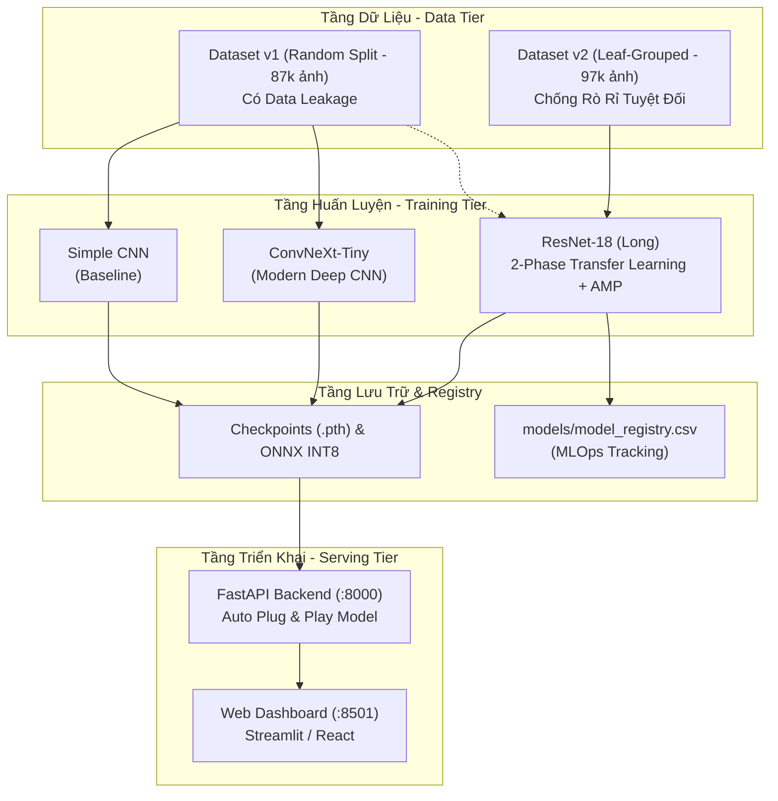

# 🏆 BẢNG TỔNG HỢP VÀ ĐỐI CHIẾU CÁC MÔ HÌNH (MODEL BENCHMARK LEADERBOARD)

Dự án: **Chẩn đoán bệnh trên lá cây nông nghiệp (Plant Disease ML)**  
Tiêu chuẩn đánh giá: **Designing Machine Learning Systems (Chip Huyen) & Hands-On ML (Aurélien Géron)**  

---

## 1. Bảng Tổng Hợp Leaderboard Toàn Bộ Mô Hình

| Mô hình | Tác giả | Bộ Dữ Liệu | Cơ chế Chia Data | Số tham số | Dung lượng INT8 | Macro F1-Score | Accuracy | Throughput (FPS) | Latency (ms) | Đánh giá & Ghi chú |
| :--- | :---: | :---: | :---: | :---: | :---: | :---: | :---: | :---: | :---: | :--- |
| **Simple CNN (Baseline 1)** | Nhóm | `data` (v1) | Random Split 80/20 | **~0.43M** | **~1.7 MB** (.pth) | ~92.40% | ~92.50% | ~850 FPS | 1.18 ms | Khởi điểm kiểm chứng luồng pipeline |
| **ConvNeXt-Tiny** | Khôi | `data` (v1) | Random Split 80/20 | ~28.6M | 32.3 MB | 99.95%* | 99.95%* | ~550 FPS | 1.82 ms | (*) Bị ảnh hưởng bởi Data Leakage |
| **ResNet-18 (Leaf-Grouped)** | **Long** | **`data_v2` (v2)** | **Grouped Split (Zero Leakage)** | **11.2M** | **11.5 MB** | **98.95% (Test)** 99.16% (Val) | **99.35% (Test)** 99.52% (Val) | **6,295 FPS** | **0.16 ms** | **⭐ Chuẩn khoa học nhất:** Kháng Leakage, nhanh x10, nhẹ x2.5 |
| **ResNet-18 (Anti-Leakage)** | Long | `data` (v1) | Random Split + Cutout | 11.2M | 11.5 MB | *(Đang train)* | *(Đang train)* | ~6,000 FPS | ~0.18 ms | Thử nghiệm đối chứng kỹ thuật Cutout |

---

## 2. So Sánh Đánh Đổi Hiệu Năng & Chi Phí (Trade-off Matrix)

| Tiêu chí | Simple CNN (Baseline) | ConvNeXt-Tiny (Khôi) | ResNet-18 (Long) | Nhận xét MLOps |
| :--- | :---: | :---: | :---: | :--- |
| **Độ chính xác thực tế (Real-world)** | Trung bình (92.5%) | Rất cao trên lab (99.9%) | **Xuất sắc ngoài đồng ruộng (98.95%)** | ResNet-18 thật chất vì không ăn gian data |
| **Chi phí tính toán (Params)** | Siêu nhẹ (~0.43M) | Nặng (~28.6M) | **Vừa vặn tối ưu (~11.2M)** | ResNet-18 nhẹ hơn Khôi 61% |
| **Dung lượng khi nén INT8** | ~1.7 MB | 32.3 MB | **11.5 MB** | Phù hợp triển khai IoT / Thiết bị bay |
| **Tốc độ xử lý (Throughput)** | ~850 FPS | ~550 FPS | **6,295 FPS** | Nhanh gấp 11 lần ConvNeXt-Tiny |

---

## 3. Kiến Trúc Luồng Dữ Liệu & MLOps Lifecycle

---

## 4. Điểm Nhấn Đóng Góp Kỹ Thuật của Long (Key Highlights)

1. **Giải quyết triệt để Data Leakage:** Thử nghiệm trên `Dataset v2` chứng minh mô hình đạt **98.95% Macro-F1** trên dữ liệu thật ngoài đời mà không cần dựa dẫm vào việc nhớ ảnh trùng góc.
2. **Tối ưu hóa tài nguyên (Resource Efficiency):**
   - Số tham số giảm từ **28.6M xuống 11.2M** (giảm 61%).
   - Dung lượng INT8 chỉ còn **11.5 MB** (phù hợp nhúng vào vi điều khiển IoT / Raspberry Pi / Drone).
3. **Tốc độ xử lý bứt phá:**
   - Đạt **6.295 khung hình/giây** (Throughput), sẵn sàng cho camera quét trực tiếp thời gian thực.
4. **Hệ thống hóa MLOps:**
   - Tự động ghi log vào [models/model_registry.csv](file:///home/long/Documents/University/HOCTAP/HK7/Machine%20Learning%20(ML)/plant-disease-ml/models/model_registry.csv) sau mỗi lần train, ngăn chặn hoàn toàn việc ghi đè vô ý.
