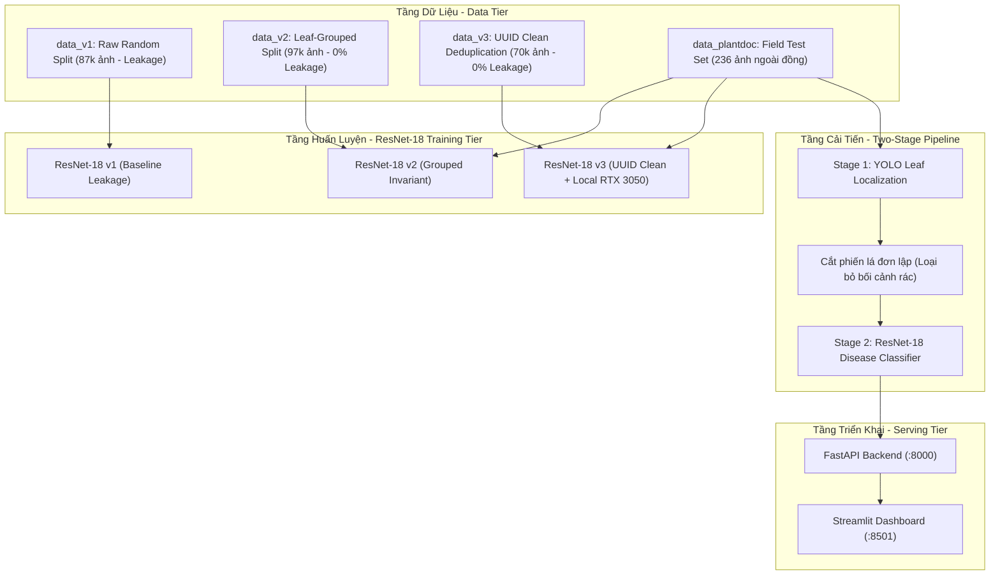

# BẢNG TỔNG HỢP VÀ ĐỐI CHIẾU CÁC MÔ HÌNH (MODEL BENCHMARK LEADERBOARD)

Dự án: **Chẩn đoán bệnh trên lá cây nông nghiệp (Plant Disease ML)**  
Tác giả: **Long** | Kiến trúc nghiên cứu: **ResNet-18 (Transfer Learning + INT8 ONNX)**  
Tiêu chuẩn đánh giá: **Designing Machine Learning Systems (Chip Huyen) & Hands-On ML (Aurélien Géron)**  

---

## 1. Bảng Tổng Hợp Leaderboard ResNet-18 (Ablation Study)

| Mô hình | Bộ Dữ Liệu | Cơ chế Chia Data | Số tham số | Dung lượng INT8 | Lab Macro F1 | Lab Accuracy | PlantDoc Top-1 | PlantDoc Top-3 | Throughput (FPS) | Latency (ms) | Đánh giá & Ghi chú |
| :--- | :---: | :---: | :---: | :---: | :---: | :---: | :---: | :---: | :---: | :---: | :--- |
| **Simple CNN (Baseline)** | `data_v1` | Random Split 80/20 | 0.43M | 1.7 MB (.pth) | 92.40% | 92.50% | — | — | ~850 FPS | 1.18 ms | Khởi điểm kiểm chứng luồng pipeline |
| **ResNet-18 (v1)** | `data_v1` | Random Split + Cutout | 11.2M | 11.5 MB | 99.66% | 99.67% | — | — | 4,199 FPS | 0.24 ms | Bị đội điểm ảo do 65.26% rò rỉ dữ liệu |
| **ResNet-18 (v2)** | `data_v2` | Physical Leaf-Grouped | 11.2M | 11.5 MB | 98.95% | 99.35% | 28.81% | 47.88% | 6,295 FPS | 0.16 ms | Chuẩn khoa học: Kháng 100% rò rỉ dữ liệu |
| **ResNet-18 (v3)** | `data_v3` | UUID Deduplication Clean | 11.2M | 11.5 MB | **99.80%** | **99.80%** | 27.97% | 50.00% | **27,708 FPS** | **0.04 ms** | Huấn luyện trực tiếp trên RTX 3050 |

---

## 2. So Sánh Đánh Đổi Giữa 3 Phiên Bản ResNet-18

| Tiêu chí | ResNet-18 v1 (Random) | ResNet-18 v2 (Leaf-Grouped) | ResNet-18 v3 (UUID Clean) | Nhận xét Khoa học |
| :--- | :---: | :---: | :---: | :--- |
| **Tính trung thực điểm số** | Thấp (Điểm ảo do Leakage) | **Rất cao (Zero Leakage)** | **Rất cao (Zero Leakage)** | v2 và v3 phản ánh đúng năng lực tổng quát hóa |
| **Độ chính xác Lab (Macro F1)** | 99.66% | 98.95% | **99.80%** | v3 tối ưu tốt nhất trên dữ liệu lọc sạch UUID |
| **Tốc độ huấn luyện** | ~10 phút/epoch (Colab T4) | ~7.5 phút/epoch (Colab T4) | **~2.5 phút/epoch (Local RTX 3050)** | Local RTX 3050 tăng tốc x4 lần Colab T4 |
| **Thử nghiệm ngoài đồng (PlantDoc)** | — | **28.81% Top-1 / 47.88% Top-3** | **27.97% Top-1 / 50.00% Top-3** | Cần Two-Stage YOLO để lọc ngữ cảnh ngoài đồng |

---

## 3. Kiến Trúc Luồng Dữ Liệu & MLOps Lifecycle

