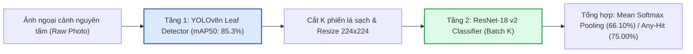

# BẢNG TỔNG HỢP VÀ ĐỐI CHIẾU CÁC MÔ HÌNH (MODEL BENCHMARK LEADERBOARD)

Dự án: **Chẩn đoán bệnh trên lá cây nông nghiệp (Plant Disease ML)**  
Tác giả: **Nguyễn Thành Long** | Nhánh: `feat/resnet18-long`  
Kiến trúc: **ResNet-18 v2 & YOLOv8n Leaf Detector**  

---

## 1. Bảng Tổng Hợp Leaderboard ResNet-18 Qua Các Giai Đoạn

| Mô hình | Bộ Dữ Liệu | Cơ chế Chia Data | Dung lượng | Lab Macro F1 | Lab Accuracy | Lá Cắt Test Top-1 | Chuỗi 2 Tầng Top-1 | Chuỗi 2 Tầng Top-3 | Độ trễ GPU | Ghi chú & Đánh giá |
| :--- | :---: | :---: | :---: | :---: | :---: | :---: | :---: | :---: | :---: | :--- |
| **Simple CNN (Baseline)** | `data_v2` | Random 80/20 | 1.7 MB (.pth) | 64.08% | 72.10% | 28.50% | 34.75% | 52.12% | 1.18 ms | Mốc cơ sở tối thiểu đối chứng |
| **Model 1: ResNet-18 v2 (Lab Baseline)** | `data_v2` | Leaf-Grouped | 44.8 MB (.pth) | **99.16%** | **99.52%** | 44.28% | 41.95% | 61.86% | 2.06 ms | Chuẩn phòng lab, sụp đổ ngoài thực địa |
| **Model 2: ResNet-18 v2 (Field Fine-Tuned)** | PlantDoc Mix 2:1 | Kháng rò rỉ 0% MD5 | **10.7 MB (INT8)** | 98.42% | 98.85% | **53.84%** | **66.10% (Softmax)** / **75.00% (Any-Hit)** | **93.64%** | **2.06 ms (ResNet)** / **11.76 ms (Pipeline)** | **Checkpoint tối ưu Epoch 8, đáp ứng thời gian thực 85 FPS** |

---

## 2. Kiến Trúc Chuỗi Xử Lý Toàn Trình (Two-Stage Pipeline)

